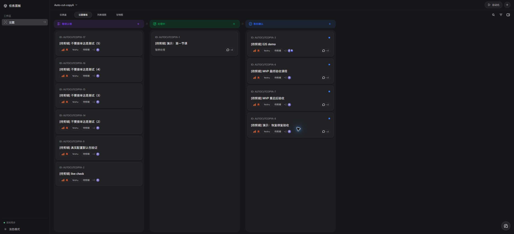

# 飞书 Bridge × Codex Taskboard

> 将飞书多维表格的状态变化，安全地转换为可追踪的 Taskboard 任务。

这是一个仅在本机运行的飞书工作流：飞书多维表格中的记录进入已配置的触发值或阶段后，本地 Bridge 通过飞书官方 SDK 接收事件、校验和整理数据，并在 Taskboard 创建受控任务；记录离开对应值或阶段时，只归档同一记录仍在“等待认领”（`todo`）的匹配任务。投递采用至少一次处理，记录会持久化，临时故障可以有限重试并在重启后恢复；Taskboard 的专用登记接口以非空 `event_id` 作为全局原子幂等键，精确重放返回已有任务，任何身份或受控上下文不一致都返回冲突。整体链路仍按至少一次语义运行，不宣称端到端 exactly-once。Bridge 不会自动启动 Codex，也不会停止 Codex；执行 Auto-Cut 的主体是 Taskboard，自动执行默认关闭。

## 数据流


所有服务只监听 `127.0.0.1`；飞书单元格不能指定工作区、命令或提示词。VM 成片归档的配置预览可单独绑定一个文本或公式字段，提供该记录的最终保存目录，经过绝对路径校验；此绑定不赋予执行资格。

飞书任务的描述标记只用于展示和事件去重。真正允许启动 Auto-Cut 的任务来源会由 Taskboard 在本机专用接口中单独登记；普通任务即使复制描述标记和 `feishu` 标签，也不会获得执行资格。Bridge 与 Taskboard 需要同时使用支持该接口的版本；如果专用接口不可用，Bridge 会把事件保留在受控重试队列中，不会退回普通任务创建。自动执行还必须同时满足：“本机设置 → 允许本机自动剪辑”显式开启、任务具有可信来源登记、活动配置快照的执行模式为 `automatic`、项目包别名存在于本机启用白名单。自动触发只由服务端在可信登记流程中生成；通用执行接口仅接受手动点击或拖拽触发，不能由请求体声明 `automatic`。可信自动任务只有在执行预约持久化后才确认登记成功；若任务创建与预约之间中断，同一事件的幂等重放会补齐预约。Taskboard 会在延迟唤醒、排队取得资源和重启恢复时重新核对当前任务的来源登记、描述标记、`feishu` 标签、执行模式与投递来源；资格被撤销时会取消预约，不能继续自动启动。模拟事件始终是测试来源，不获得自动执行资格；升级前未持久化来源的非终态队列记录也会保守降级为模拟来源，只能手动执行。同一非终态事件重新领取时，已存事件、冻结决策和本次重放中的来源证据只会向更保守的模拟来源合并，不能把模拟来源重新升级为真实飞书来源。

每个 Base/子表的 Taskboard 隔离项目 ID 固定为 `feishu-` 加上 `sha256(baseToken:tableId)` 的前 16 个十六进制字符；Bridge 和 Taskboard 必须保持这一规则一致。旧项目 ID 不会自动改写，新投递统一使用 16 位规则。

## Auto-Cut 执行环境与制品登记

包管理的 **验证并读取** 要求工作区提供两份 Taskboard 接入声明：`.codex-plugin/plugin.json` 和 `PACKAGE-MANIFEST.json`。独立剪辑源码包即使已有 MP4 CLI，也须先适配 Taskboard 的输入、执行和结果接口；缺少或无法读取声明时，页面会列出文件名并阻止登记，不能仅复制示例声明后启用。VM 配置预览示例只用于隔离验收，不会自动登记到本机包列表。

Auto-Cut 包管理中的 **ZIP 生成目录** 支持读取工作区根目录 `PACKAGE-MANIFEST.json` 的可选声明 `interface.zipOutput.relativeDirectory`，例如 `"output"`。填写工作区后点击 **验证并读取**，Taskboard 只读清单，预览并带入工作区内的绝对目录；此时不会创建目录或保存配置。之后显式 **保存草稿 / 启用** 才会重新读取声明并准备目录，再保存用户确认的设置。声明不能是绝对路径、盘符或 UNC 路径，不能包含空段、`.`、`..`、Windows 非法名称或越出工作区的目录链接；无权限等失败会显示错误并阻止后续保存。接口为 `POST /api/local/autocut/packages/prepare-output-directory`，只接受 `workspacePath`，目录由服务端清单决定。

旧包没有该声明时继续保留手动配置，不猜测默认目录。页面提供“Auto-Cut-Lite 默认目录 / 自定义目录”选择：默认模式读取并在保存或启用时创建清单目录；自定义模式要求填写本机可访问、已存在且可写的绝对目录，Taskboard 只读校验，不替你创建任意自定义目录。页面加载和软件升级不会重写已有路径、包别名、项目 ID 或任务快照；主动验证带入的新路径在保存前仍是未保存配置。ZIP 生成目录是本机剪辑产物的来源，课程目录及 NAS 上传目标仍由学科的存储配置决定。每次运行的准确 ZIP 路径继续由 Taskboard 通过 `CODEX_AUTOCUT_PACKAGE_ZIP_PATH` 指定，Auto-Cut-Lite 必须生成并上报这一文件；不扫描目录或推断“最新 ZIP”。

phased 任务的 ZIP 根目录优先使用任务冻结包快照中的 `zipSourceDirectory`（兼容 `artifactSourcePath`）。包未配置该可选字段时，使用同一任务 `configVersion` 冻结学科配置中 `upload.artifactSourceMode = driver_report` 的 `upload.artifactSourcePath`。生成和制品登记使用同一规则，显式无效路径仍会阻断，登记仍要求 ZIP 根目录与该冻结学科来源一致；不会改用当前配置、工作区或上传目标路径，也不会改写旧任务快照。

通过所有自动执行门禁的 phased 任务（包含重启恢复的预约）直接使用 Taskboard 已有的本机 Auto-Cut runner。runner 读取当前 Windows 用户 `%LOCALAPPDATA%/Auto-Cut/auto-cut-lite/deployment-report.json`，核对 `workspace_root` 与白名单项目包相符，使用报告内固定 Python 和 runtime 中的 `scripts/jy_wrapper.py`。受阻任务通过“按当前配置重新执行”在原卡片启动新一轮：使用已启用的当前配置和最新受控记录值，显式授权本轮视频原音语音识别及配置输出目录写入，并保留旧运行与历史配置。点击授权前不会启动，授权也不会保存或沿用到后续运行。

启动前检查在与 runner 相同的 Windows 账号、环境和访问权限下执行，默认最多 30 秒：

- `components.lark_cli.path` 必须是可读的绝对 CLI 文件路径。Windows 当前支持已安装包的 npm shim 布局（`.ps1/.cmd/.bat`），还须能读取同目录的 `lark-cli.cmd` 及 `node_modules/@larksuite/cli/scripts/run.js`；Taskboard 使用固定 Node 运行入口，并向 Auto-Cut 注入该 CLI 和 Node 所在目录。若 CLI 同目录存在另一个 `node.exe`，或报告指定原生 EXE/JS 等无法保证与 Python 自动发现一致的入口，检查会阻断，需修正本机安装布局。
- 该账号必须可访问 CLI 已有的用户配置/认证目录与其使用的系统凭据存储。继承该账号的 `HOME`、`USERPROFILE`、`APPDATA` 等定位环境，以 `whoami` 返回 `available: true`、`identity: user`、`defaultAs/default_as: user` 为可用条件；不复制凭据、不自动登录、不输出身份回执或 CLI 原始错误。此检查不代替具体飞书文档权限校验。
- readiness 默认是 `%LOCALAPPDATA%/Auto-Cut/auto-cut-lite/runtime-readiness.json`，可用服务环境变量 `AUTOCUT_LITE_READINESS_PATH` 指定绝对路径。已有文件必须可读写，父目录必须允许创建、写入和删除临时文件；本次检查不改写 readiness 内容。当前 run 的 job、drafts 和 ZIP 父目录须具备相同临时文件访问条件。

配置缺失或访问失败会以 `AUTOCUT_RUNTIME_UNAVAILABLE`、`AUTOCUT_LARK_CLI_UNAVAILABLE`、`AUTOCUT_LARK_IDENTITY_UNAVAILABLE`、`AUTOCUT_READINESS_UNAVAILABLE`、`AUTOCUT_OUTPUT_UNAVAILABLE` 等明确原因阻断。环境探测、Auto-Cut 预检及完整运行的默认期限依次为 30 秒、120 秒、2 小时，可通过 `CODEX_TASKBOARD_AUTOCUT_ENVIRONMENT_TIMEOUT_MS`、`CODEX_TASKBOARD_AUTOCUT_PREFLIGHT_TIMEOUT_MS`、`CODEX_TASKBOARD_AUTOCUT_RUN_TIMEOUT_MS` 设置正整数毫秒值（最大 2147483647）；服务重启后生效。预检完成信号从 Auto-Cut 的 stderr JSON 进度读取，超时会终止该次子进程树并记录对应 `*_TIMEOUT`，不持续显示无解释的“处理中”。

剪辑完成后 Taskboard 读取该 run 的结果回执，计算精确 ZIP 的 SHA-256，经已有本机接口用专用 claim 凭据登记，再核对已入库的 verified 制品和任务/run 绑定后完成任务。登记请求及响应正文限时 5 分钟，失败记录 `AUTOCUT_ARTIFACT_REPORT_FAILED/TIMEOUT/INVALID` 并释放执行占用；从关闭服务开始计算的总时间还包括当前 ZIP 文件 IO。该路径不依赖 `taskctl` 的 PATH。保留的 Codex 路径使用服务注入的 `CODEX_AUTOCUT_TASKCTL_NODE` 与 `CODEX_AUTOCUT_TASKCTL_PATH`，无需 AI 查找命令。全部流程保留专用凭据、ZIP 哈希、结果回执校验以及来源、白名单、loopback 和自动执行开关边界。

验证使用临时数据库、独立任务和受控 runtime/CLI fixture，覆盖启动、模拟剪辑产物、真实 ZIP 校验登记到 Taskboard 完成，以及 CLI/认证/readiness/超时和登记失败。它不代表真实媒体剪辑验收；须待 Auto-cut-lite 预检修复包可用后，在独立测试学科/示例项目验证同一全链路。模拟 Bridge 事件仍没有自动执行资格。

本轮源码交付不改变运行中的服务。部署时先完成代码评审和 `npm test`，待现有任务与上传结束，在维护窗口停止服务并备份现有 `.env.local`、本地配置、Taskboard 数据目录和 Bridge 状态；合入已评审源码，保留所有现有配置、凭据及状态，以原账号、原开关和原配置运行 `scripts/start-local.ps1`，再运行 `scripts/check-local.ps1`（真实长连接用 `-RequireFeishu`）。先做模拟投递安全回归，再用独立测试表的真实事件验证更新后的 Auto-cut-lite：启动 → 剪辑 → ZIP 校验登记 → `done`。不要重放已完成的 FEI-29，也不要删除状态或锁文件。

### 飞书文档链接兼容

受阻的文档 ZIP 任务仅提供“按当前配置重新执行”：先保存并启用所需配置，再点击原卡片，在同一任务中生成新一轮运行；有空闲槽位进入处理中，否则排队。不会生成新卡片，原任务编号、历史配置、运行、日志和制品保留。“重试 Auto-Cut”旧按钮已移除。并发旧版本点击返回冲突；排队期间重启会取消本次未启动授权并返回受阻，不会自动补跑。

文档型 ZIP 流程只从学科配置绑定的文档字段读取 HTTPS 飞书 `docx` / `wiki` 链接。Bridge 接受裸链接，以及带非空、各不重复的 `from`、`pre_pathname` 来源／导航参数的链接（可组合），例如复制链接自带的 `?from=from_copylink`；进入任务上下文和来源 manifest 前自动去掉这些参数，同一文档的不同分享形式合并为一个候选，无需逐条清理正常的复制链接。字段仍须指向唯一文档，文档访问权限仍由后续读取检查。

带其他参数、重复或空参数（含多余的 `&`）、非法百分号编码、解码后含控制字符、锚点、嵌入凭据、非飞书域名或异常路径的链接继续阻断。`document_link_missing` 表示绑定字段中没有识别到有效文档链接，不等于文档编辑权限不足。更新 Bridge 后，已因该错误阻断的旧任务需先修复并启用配置，再从原任务卡片点击“按当前配置重新执行”；该操作重新读取受控文档字段，不改写历史运行，也不自动补跑其他任务。

## 剪辑包流程模板与独立配置草稿

包管理读取 `PACKAGE-MANIFEST.json` 的 `interface.workflowTemplate`，按固定模板身份显示配置。历史包没有声明时继续解析为 `document_draft_zip` v1，使用现有文档、草稿和 ZIP 流程；`vm_pmo_review_video` v1 支持 PMO VMID 来源、下载申请部门/原因与“初稿 / 审核修改”两阶段配置草稿。两种模板均按“学科＋包别名＋模板 ID＋模板版本”分别保存。切换包恢复各自的配置，同一包在不同学科也不会共用参数。

VM 草稿的「视频来源」绑定 PMO 文本字段，不逐条填写视频 ID。初稿在状态进入触发选项后读取该记录的 VMID，申请并等待审批，下载后读取初稿阶段的「初稿意见」首次编辑原视频。记录首次创建或首次填写进度时，如果没有前值、当前值直接是已启用的初稿触发选项，也会登记初稿任务；审核阶段仍要求从另一有效选项进入审核触发选项。不会扫描或补跑启用前已经停在触发选项的历史记录。审核修改读取「审核意见」及可选意见附件，并以 Taskboard 已确认交付的上一轮 MP4 为唯一 parent，不重新申请 VM 下载。Taskboard 冻结并透传原始修改意见；语义理解、删词定位和实际剪辑由 Auto-Cut 包负责，Taskboard 编排轮次并校验回执绑定与 MP4 产物。新的可执行 VM 包在初稿与审核阶段均须显式声明 v2 contract 和固定 `vm_pmo_review_video_v2` driver，使用 schema v2；v1 输入与回执仅保留历史读取和离线校验兼容。协议支持明确保留区间和源哈希绑定的语音删词、静音或 cue。缺少词级证据、匹配重复或保护词冲突时由剪辑包阻断。每阶段独立配置触发选项及开始、交付完成回写，并统一选择成片附件目标。保存草稿不会发起审批、执行剪辑或回写 PMO；需完整配置并显式启用，之后只对真实状态进入触发选项的事件触发。

在「基础与执行」中只选择一次「视频主体命名字段」，接受 PMO 文本或公式字段，初稿、审核修改与最终成片共用同一个名称主体。命名规则分别为 `<共同名称>_初稿.mp4`、`<共同名称>_第N稿.mp4`、`<共同名称>.mp4`；最终成片不追加阶段后缀。Taskboard 在登记审核任务时冻结父片、意见和递增编号，失败重试沿用同一编号与输出名。存储与目录页另有可选「成片归档」配置，按单选进入或多选新增指定选项触发，将同一记录已确认交付的最新 MP4 发布到 `<指定目录>\<共同名称>.mp4`，不重新剪辑。指定目录可手动输入，也可从所选 PMO 文本或公式字段读取；不再选择课程目录命名字段，也不追加课程名或 `00成片`。两种来源均要求 Windows 绝对盘符路径或完整 UNC，字段模式不回退使用手动路径。

成片归档默认关闭；草稿中开启时须完整设置触发字段/选项、路径来源及对应目录或路径字段，并选定共同视频命名字段，且触发绑定不得与已启用剪辑阶段使用同一字段及选项。最终 MP4 不按附件顺序或文件修改时间猜测。归档 worker 只消费附件读回确认后持久化的最新成片指针，按 SHA 校验来源，并以无覆盖方式发布：同名同 SHA 为幂等完成，同名异 SHA 显示冲突。保存配置不创建目标目录或复制视频。

旧 VM 三阶段草稿读取时转换为两阶段视图，保留现有 revision，不写入数据库。初稿意见优先采用旧初稿阶段意见，再采用旧切片意见字段。审核修改沿用一个完整旧阶段：优先已启用初审，其次已启用终审，再其次有配置的初审，否则沿用终审；该阶段意见未选择时兼容旧审核意见文本字段，审核附件同步带入审核修改。界面提示合并来源，须核对后保存；显式保存只保留 `initial / review` 和各自意见、回写，不保留隐藏的初审、终审或顶层默认意见。Auto-cut-lite 的 ZIP 三阶段配置保持原有规则。

共同视频命名字段只保存在 `fields.namingFieldId`，阶段和成片归档不再有独立命名绑定。旧独立命名绑定相同时，GET 合并为该共同字段；存在不同非空绑定时不猜选，共同字段返回 `null`，并以外层 `legacyNamingConflict: true` 提示重新选择。缺少命名字段或成片归档配置的旧 VM 草稿，只补齐空绑定与关闭的归档默认值。已有旧根路径或课程目录绑定的草稿返回 `legacyArchivePathNeedsReview: true`，保留归档触发配置，但清空新目录绑定，须显式填写具体目录后保存，避免把旧根目录误用为最终目录；以上 GET 均不落库、不增加 revision。显式保存仅接受新的完整配置结构并清除兼容提示；未知配置键、无效路径以及与实时字段类型不匹配的绑定均被拒绝。

VM 配置错误区分未知/旧配置项与实时字段绑定问题。只有该配置请求成功恢复后才清除其对应的旧错误；字段刷新失败保留提示，成功刷新不会清掉其他操作的错误。实际字段或选项缺失仍需重新选择，不能用隐藏提示代替修复。

学科配置页分别显示当前编辑的包草稿与当前生效的包。切包和保存草稿不会修改 Bridge 的活动配置；只有显式启用已保存的草稿并同步成功，才替换生效版本。草稿使用独立 revision，启用同时检查草稿 revision 和学科配置版本，产生学科全局下一个版本。遇到版本冲突需先核对最新配置；同步失败保留原活动快照，历史任务继续使用自己的冻结配置。

两种流程共用「基础与执行 / 素材与阶段 / 存储与目录 / 飞书回写」四个配置分区。VM 的共同视频命名字段在基础与执行中选择一次，初稿、审核修改触发及各自意见集中在素材与阶段，并显示各自命名后缀提示；审核意见附件位于审核修改阶段。成片附件目标和 NAS 成片归档配置在存储与目录，最终文件名预览引用共同命名；两个阶段各自的开始剪辑及交付完成状态在飞书回写。包选择与编辑/生效摘要合并为紧凑顶栏；仅配置详情滚动，页签和右下方保存、启用操作栏保持可见，切页保留未保存输入。

已有 ZIP 包从该包最近的学科配置历史恢复，无需重新填写；没有历史的新包使用保守默认值，不继承另一包的自动执行模式、目录或回写配置。保存包草稿后，该学科下次打开时优先显示最近保存的编辑包；此偏好单独保存在本机，不改变当前生效包或 Bridge 路由，已有包草稿按最近保存时间恢复偏好。未保存修改在当前配置面板中按完整包身份暂存，切换包或学科后可恢复；离开配置页或刷新时提示保存。需要跨刷新或服务重启保留的修改须先保存草稿。旧学科保存、共享导入和字段刷新入口继续兼容，并维护对应包档案。

未选择包或原包已不可用时，先选择可用包再编辑流程。刷新字段会重新读取草稿版本并保留未保存输入；若另一窗口也修改了同一字段，则保留输入并阻止保存、启用，须核对后重新加载。共享导入更新当前缓存时，未修改的草稿自动重读，有未保存修改的草稿保留输入并提示确认后重新加载，避免覆盖新版本。

本机接口 `GET/PUT /api/local/feishu/subjects/:subjectKey/package-workflow-drafts/:alias` 读取/保存两类草稿；PUT 接收 `{expectedRevision, config}`。启用使用同路径的 `POST /enable`，接收 `{expectedRevision, expectedVersion}`，重新校验字段、选项、包启用状态和真实 manifest；VM 另需本机运行时就绪、协议 v2（审核启用时）及每个启用阶段的完整配置。接口沿用 loopback、Host/Origin 和未知字段校验。普通草稿不会增加包删除占用，已删除包的档案不可使用；活动配置和未完成任务仍保护其引用的包。共享导出仍使用现有可移植学科配置，不包含额外的本机包档案或本地目录。

可在包管理选择仓库内 [VM 配置预览示例](examples/vm-pmo-review-video-preview) 的绝对目录，检查包后保存草稿，再在学科配置中选择该包查看专用表单。示例只有身份和模板声明，没有运行时或剪辑执行器；无需填写 ZIP 输出目录或模型，启用返回 `PACKAGE_WORKFLOW_NOT_READY`。已保存别名的模板身份不可更换，使用另一流程须注册新别名。未知模板、版本或不匹配的协议/驱动声明均被拒绝；登记和执行前复核真实 manifest，不能靠省略 API 字段进入旧 ZIP runner。

VM/PMO 有独立运行时：Bridge 认证专用登记 → 初稿审批下载或审核 parent 冻结 → 本机 `plan/render` → 唯一 MP4 校验 → PMO 附件上传并读回 → 阶段完成回写。任务、可信来源、配置与包快照、本次自动预约意图在同一数据库事务中登记，任一步失败全部回滚。每个初稿 task/run 冻结首次生成的审批请求；后续本机下载设置不会改写历史请求。Taskboard 启动时只会恢复尚未启动 plan/render、仍绑定原 `ready` 审批且采集回执和源文件摘要复核通过的 `VM_TASK_BINDING_CONFLICT` run，沿用同一审批和 run。可分别启用 `initial` 与 `review`，审核只接受上一次 Taskboard 确认交付的成片；启用审核须使用真实 manifest 声明 v2 driver。Bridge 启用 VM 配置时独立读取实时 Base 元数据，严格核对 VMID、共同命名、阶段意见、成片附件字段类型，以及各启用阶段的触发、处理中和完成回写选项；缺失、重名或类型变化会阻止启用，不要求旧 ZIP 流程的 `trigger` 字段。Taskboard 向 Bridge 同步 VM 模板、字段绑定及共同命名字段，Bridge 保存独立 VM 快照，不生成 ZIP 专用上传配置；本机归档目录在传输和 Bridge 存储中清空。等待初稿审批不占剪辑槽，审核不再申请 VM 下载；关闭本机开关取消未开始预约，重新开启不补跑历史。成片归档另由认证 Bridge 请求启动持久 worker，只读取确认交付指针并校验 SHA，无覆盖发布。旧 ZIP 路由和通用执行入口仍拒绝 VM。真实 render 启动后才回写处理中，附件读回确认后才回写完成；回写重试会拒绝已被新阶段或已登记的新审核轮取代的旧任务，并在 Bridge 写入前复核阶段状态；附件/字段更新之间仍受飞书无条件写入竞态限制。若 VM run 已完成、Taskboard 仍为“待验收”且处理中与完成两条回写意图都进入 `dead_letter`，任务详情会显示具体错误码并提供受限的“重试进度回写”；该入口只重排同一 task/run 的原意图，不重新申请、下载、渲染或上传。旧生产 ZIP 发布条件保持独立。配置和离线验收见 [VM / PMO 联调](docs/vm-pmo-offline-integration.md)，其中说明飞书附件更新接口不提供 CAS 的并发边界。接口设计见 [模板设计](docs/superpowers/specs/2026-10-09-package-workflow-templates-design.md) 与 [VM / PMO 接口草案](docs/superpowers/specs/2026-10-09-vm-pmo-review-video-interface-draft.md)。

真实飞书 `vm_pmo_review_video` 的 `final_archive` 事件进入 Bridge `dead_letter` 后，可在核对原触发边沿、冻结配置及获准交付来源后，用 `scripts/retry-vm-final-archive.ps1` 受限恢复。恢复必须提供同一条 Taskboard 已确认交付的 run、delivery、artifact、SHA-256 和字节数；Taskboard 会重新解析并核对来源，已有归档作业则核对其冻结来源。归档目录由原事件绑定的配置版本解析，文件名由实时校验过的共同命名字段解析，并在首次归档登记时与来源一起冻结；脚本不接受目标路径。恢复请求只重排同一事件，保留原失败记录；身份一经绑定不能替换，新轮次、状态变化和归档冲突仍会阻断。HTTP 202 只表示恢复请求已记录，须核对看板中该轮归档状态为 `published` 才算完成。此入口不通用重放其他死信：

```powershell
.\scripts\retry-vm-final-archive.ps1 `
  -EventId <event-id> `
  -RunId <run-id> `
  -DeliveryId <delivery-id> `
  -ArtifactId <artifact-id> `
  -Sha256 <sha256> `
  -Bytes <byte-count>
```

VM 详情中的「重试语音识别与规划」只对尚未渲染且错误码精确为 `WORD_ALIGNMENT_UNRESOLVED` 的运行显示，限制为三次规划尝试。确认前须分别授权原视频音轨 ASR 与新本机规划文件写入。重试复用原 task/run、ready 审批及同一素材，并重新校验采集回执和源 SHA；每次规划使用独立不可覆盖目录，旧失败记录保留。审批失效、素材变化、其他错误、已有 render/制品证据或达到次数上限时均不能重试。该入口只服务本机 loopback，不改变旧 ZIP 通用 Auto-Cut 的重试规则。

旧版任务绑定若只与 task/run 专属审批 job 在 `private_endpoints` 有差异，Taskboard 仅在原 job id 可重新计算、其他请求字段完全一致且 `ready` 回执和源文件摘要复核通过后迁移绑定；该过程沿用已下载文件，不重新申请或下载。

归档发布会把映射盘解析到已冻结的 UNC 目标，再使用同一目标进行无覆盖复制／发布；映射变更、符号链接或与冻结目标不一致时阻断。历史上在复制前因 `VM_ARCHIVE_DIRECTORY_INVALID` 进入 `conflict` 且尝试数为 0 的作业，可由本机维护人员通过认证的 `POST /api/local/feishu/vm/final-archive/retry-directory` 显式恢复：请求与原登记相同，并必须提供 `expectedSource` 五项成片身份。该接口要求 Bridge 共享密钥及专用 header、loopback Host/Origin，只重排原作业，不解析新目标或新来源；恢复前复核当前轮次、MP4 摘要及冻结目录，并在 `vm_final_archive_recoveries` 保留原错误和计划摘要。其他冲突不允许恢复，也不会自动补跑。

### 剪辑包独立看板与自动审核闭环

学科看板可按剪辑包切换；任务、历史轮次、视图和列名按学科、包别名及模板版本分别保存。切换看板只改变查看范围，不启用配置、不补跑任务；顶栏另行显示当前生效包。已删除包的历史使用可信任务快照保留，不能借此重新执行。旧学科视图仍保留兼容；普通任务不获得包的执行权限。

Auto-cut-slicing 的业务列为：待处理 → 素材准备 → 排队中 → 剪辑中 → 回写飞书 → 等待飞书审核 → 上传 NAS → 已完成，失败进入需要处理。状态读取接口 `GET /api/local/feishu/package-board?subjectKey=…&packageAlias=…` 只投影已持久化的任务、运行、审批、回写及归档凭据，不启动 worker、不读取远程数据，也不返回素材路径、意见或凭据。PATCH 同路径只更新本包的显示偏好，使用 revision 防止覆盖其他窗口修改。

初稿仍走正常 VM 审批下载，等待审批不占剪辑槽；真实 render 启动后回写配置的“剪辑中”等选项。唯一 MP4 上传并读回确认后，回写审核就绪选项，等待多维表格的审核结果，无需本机点击验收。进入审核修改选项时，冻结新意见和上一轮已确认 MP4，生成下一轮；可持续重复，审核轮不申请 VM 下载。进入完成／成片归档选项后，冻结本轮获准成片及 NAS 目标，校验 SHA、无覆盖发布成功才显示业务已完成。通用任务的内部 `in_review` 仍表示该轮交付完成，VM 看板将它投影为等待飞书审核；不据此宣称 NAS 已完成。

初稿、审核修改和归档可共用一个进度字段；归档只接收真正进入归档选项的边沿，不截获其他阶段。审核父成片和归档源严格绑定同一包、模板、学科、记录及附件字段；并发审核登记重新核对父轮，归档重试不会改用更新成片。已经完成且附件读回确认的轮次，后续审核／归档复核冻结输入、可信身份和交付 MP4 的 SHA／字节数，不再依赖已清理的初稿下载视频；输入文件变动、交付身份或 MP4 摘要不符仍阻断。尚未确认交付的执行、上传及规划重试继续要求原素材校验。Bridge 成片归档登记使用至少 30 秒的有限等待预算，以容纳飞书实时字段／记录读取和本机校验；其他本机请求保留原超时。ZIP/Lite 的完成条件及上传流程保持独立。离线联调用实际执行器验证初稿 → 两轮审核修改 → 归档；开发验证不写真实飞书或 NAS。

审核截图字段可配置为可选附件；单元格为空、缺省或空数组时按文字意见继续。当前 VM/PMO v2 driver 未提供截图文件输入和图片识别接口：有截图时登记／执行前复核返回 `VM_REVIEW_IMAGES_UNSUPPORTED`，不忽略图片后继续交付。截图自动解读需要同时扩展剪辑包和 Taskboard 协议。

## VM 素材下载验证

新增独立审批 CLI `taskboard/cli/vm-approval.mjs`：将 VMID、部门、原因和本机下载配置写入 SQLite 队列，经 `run --login` 正常 Shadow SSO 后提交一次申请、等待批准与制作完成，再领取并校验至少 1280x720 的文件；更高分辨率可用。手动下载仍按规范化请求复用队列项；受控 VM 初稿按 `task/run` 幂等，同一任务重放复用原申请，不同任务可对同一 VMID 独立申请。资源地址摘要按 VM 申请编号隔离，同一申请不可经不同任务重复领取相同素材，不同已批准申请可分别领取相同素材。支持查看状态、中断恢复、有限重试、响应不明时核对申请和该申请范围内的资源地址占用；状态库不保存令牌或下载 URL。`run` 默认最多等待 30 分钟，进程结束后须再次运行，重启后重新登录。现有 `vm-source.mjs` 继续支持操作者提供已获批 URL 或本机 MP4。用法、状态恢复和边界见 [VM 素材采集验证](docs/vm-source-acquisition.md)。

已在公司 VPN 下完成真实 720p 下载与全量解码，并验证后台申请及获批资源查询；新审批 CLI 已通过正常 SSO 接管既有获批测试申请、复用精确回执并重新核对文件摘要，返回 `ready`，无重复申请或下载。Taskboard VM 初稿与手动下载共用审批队列；手动下载按规范化请求复用，初稿按 `task/run` 隔离申请幂等，精确申请指纹校验请求内容但不再跨初稿任务唯一化。新 worker 的全新申请到首次下载、渲染和 PMO 交付仍须真实测试记录验收。当前接口与 SSO 回调沿用 VM 现有前端契约，长期自动续期未实现。

## 当前已支持

| 能力 | 说明 |
| --- | --- |
| 飞书事件接收 | 使用飞书官方 Node SDK 的长连接接收多维表格记录变化。 |
| 安全路由 | 按 Base、表、字段、状态值和项目包别名筛选事件。 |
| 幂等去重 | 已持久化成功的同一 `event_id` 重放会返回 `duplicate`，正常重放不会再次创建；整体投递语义仍是至少一次。 |
| 任务标题回退 | 优先读取“视频名称”，其次“集合文档”，失败时回退到飞书记录 ID。 |
| Taskboard 集成 | 通过本机 Bridge 专用来源登记接口创建待办；记录离开可开始值时只归档匹配的 `todo` 任务，不改动处理中或已完成任务；Bridge 不启动 Codex。Taskboard 自动执行策略默认关闭。 |
| 三阶段工作流 | Taskboard 管理的活动配置可分别启用 `initial`、`first_review`、`final_review`；“初稿触发字段”用于初稿，“审核修改触发字段”共用于初审修改和终审修改。审核字段未单独选择时兼容使用初稿字段。Bridge 只在记录从其他 option 进入已启用阶段 option 时登记该阶段任务。 |
| Auto-Cut 与产物 | Taskboard 负责统一执行入口、并发控制、Auto-Cut 调用、剪映草稿/ZIP 校验以及本地或 NAS 上传；这些能力不在 Bridge 进程中执行。 |
| 可靠投递 | 投递状态持久化重试，临时 Taskboard 故障按有限退避处理，Bridge 重启后恢复未完成租约。 |
| 死信可见性 | 超过重试上限的事件进入 `dead_letter`，可从健康接口的队列计数定位。 |
| VM 成片归档恢复 | 仅对真实 VM `final_archive` 死信提供绑定 run、delivery、artifact、SHA 与字节数的本机受限重试；其他死信仍不可手工重放。 |
| 状态文件保护 | 损坏的状态文件、无效租约或不完整快照会安全停留在可诊断状态；读写（包括健康队列统计）使用同一稳定路径校验和操作系统本机互斥锁，写入使用原子替换，崩溃后可安全恢复。状态文件必须是稳定的普通文件，不接受符号链接或硬链接别名。 |
| Base 元数据预览 | `POST /api/feishu/base-preview` 只接受携带 `x-feishu-bridge-client: taskboard` 和本机共享密钥的 Taskboard 请求；在本机配置飞书凭据后，它仅执行只读 metadata 操作，按 Base 链接读取 Base、子表、字段和单选项元数据。即使长连接监听关闭，预览仍可使用，且不会启用子表或接收事件。 |
| Base 事件订阅 | Taskboard 左侧多维表格目录可读取、订阅或取消一个 Base 的记录变更事件订阅。操作由 Bridge 通过飞书官方 SDK 完成，浏览器不会获得飞书凭据；订阅管理要求操作者拥有该飞书文档。 |
| 学科配置复用 | 学科配置页中的“导出学科配置”导出当前所选包已保存的配置，支持 Auto-cut-lite ZIP 和 VM 流程；“导入学科配置”只应用到当前目标学科。字段按唯一名称及类型匹配，选项按所属字段中的唯一名称匹配，不照搬来源表 ID。旧版多学科共享文件须先选择一个来源学科。预览显示来源、目标及待补齐项；确认只保存目标包草稿，保留目标身份、显示状态、本机路径和正在生效的版本，不新增或恢复文件中的 Base/学科。缺失或重名字段保持待修复，启用时再严格校验。接口为 `GET /api/local/feishu/workflow/subject-share/export` 和 `POST /api/local/feishu/workflow/subject-share/import`；提交携带目标学科版本与包草稿版本，防止覆盖并发修改。 |
| 旧版目录共享接口 | 旧版 `/api/local/feishu/workflow/share/*` 仅保留兼容，不再作为面板的学科复用入口。导入跳过已有活动版本及已移除的 Base/学科，不会通过清除移除标记恢复目录；分别返回 `ENABLED_SUBJECT_SKIPPED`、`REMOVED_BASE_SKIPPED`、`REMOVED_SUBJECT_SKIPPED`。共享文件不含绝对路径、工作区、启动 prompt 或凭据，仍须在目标机器绑定目录。 |
| SDK-managed 监听 | 显式启用官方 SDK 自动重连；健康状态使用 `sdk_managed`，不伪造物理连接确认。 |
| 健康检查 | 一条命令检查 Node、配置、Taskboard、Bridge、监听器状态和 pending/retry/dead-letter 队列计数。 |

## 界面展示



上图为使用本地测试数据的真实 Taskboard 看板，展示了待办卡片及“等待认领”“处理中”“等你确认”等看板状态。本仓库内置的 Taskboard 负责界面、人工操作和受控 Auto-Cut 执行；Bridge 只负责事件接收、规则判断和任务登记/归档。真实业务任务的可见范围仍应由团队权限和 GitHub 仓库权限控制。

## 本地配置详情

首次运行时，`start-local.ps1` 会从 `config/bridge.example.json` 生成被 Git 忽略的 `config/bridge.local.json`，并从 `config/autocut-packages.example.json` 生成独立的 `config/taskboard-feishu-packages.json`。两个文件只在目标不存在时创建，不会覆盖已有配置。示例文件包含占位符，不能直接用于真实飞书或模拟建任务；请先在本机填写测试 Base、表、字段 ID，并在 Auto-Cut 包 registry 中配置包。

### 学科的自动 / 手动剪辑开关

在 Taskboard 的飞书工作流配置中选中学科，打开三阶段配置上方的 **通用执行设置 → 剪辑模式**，选择“自动”或“手动”。每个学科只有一个剪辑模式，初稿、初审修改、终审修改共用；并发数和资源组由所选 Auto-Cut 包管理，阶段任务始终按同一包串行执行。

读取或刷新 Base 元数据时首次发现的学科（例如新建的“高中历史副本”子表）默认生成“自动”草稿，补齐字段、Auto-Cut 包和阶段目录等必要设置后，仍须 **保存草稿 → 启用** 才会生效。新学科默认不选择剪辑包，不再注入示例别名；未绑定包的草稿可保留、停用和移除，启用时必须先选择包。未绑定且从未启用的学科仅在本机处理，不登记 Bridge 路由。路由下拉框只列出当前包列表中的包；旧配置引用的包已删除时显示“未选择”并提示重新选择，历史配置及活动快照保留，不会自动改绑。现有学科都显示这个开关，并保留原来的自动或手动值；刷新、移除后恢复不会批量改为自动。历史配置修复及共享配置导入缺少执行模式时，继续保守使用手动。

页面右上角“本机设置 → 允许本机自动剪辑”提供可点击的总开关，学科配置页也可通过“修改本机总开关”进入。设置立即生效并在本机数据库中保存，重启后保留；默认关闭。只有尚未保存设置时，`CODEX_TASKBOARD_ALLOW_AUTOMATIC_EXECUTION` 才提供初始值，之后界面保存的选择优先（包括关闭）。关闭取消尚未开始的自动延迟或排队预约，排队任务回到待处理，正在执行的剪辑与手动任务继续；重新开启本身不会补跑历史任务。学科选择“自动”不会改变总开关。新任务还必须满足可信 Bridge 登记、已启用活动配置和本机启用包白名单等条件，模拟来源不能自动执行。素材文档、命名、触发或附件字段尚未选齐时，可保存草稿并在切换学科或重新打开后继续配置；启用前仍须补齐全部必填绑定。无效参数、重复字段/选项和冲突绑定仍会阻止保存。保存草稿期间原活动配置继续有效，点击启用后由新配置处理后续触发；已有任务的模式和运行状态不会追溯修改，也不会自动重跑。ZIP 与上传中的“上传入队”仍单独控制。

修改章节锚点等工作流配置后，先保存并启用新版，再在受阻任务内点击 **按当前配置重新执行**；它会读取当前配置和最新受控记录值，在原任务卡片开始新一轮并保留旧运行，无需反复切换飞书状态。新入口仅适用于可信生产来源的三阶段 ZIP 任务，每次点击明确授权本轮原音 ASR 与配置输出目录，普通任务、模拟来源和 VM 流程不能使用。去重、重启和永久删除规则见 [Taskboard 使用说明](taskboard/README.zh-CN.md)。

### Base 事件订阅

页面加载或刷新后，左侧 **多维表格** 目录会自动查询所有 Base 的真实事件订阅状态，包括折叠项；名称旁会显示“事件已订阅”“事件未订阅”或“读取失败”。自动查询只读取状态。点击该 Base 的更多菜单可 **刷新订阅状态**，或按当前状态选择 **订阅事件** / **取消订阅**。订阅是整个 Base 级别的能力，会覆盖其下所有已启用学科；取消订阅只停止之后的飞书记录变更通知，不会暂停、归档或删除已有 Taskboard 任务，也不会修改飞书记录。

订阅状态与本机监听器状态相互独立。订阅成功后，仍须以 `start-local.ps1 -EnableFeishu` 启动本机官方 SDK 长连接，Taskboard 才会接收后续事件；启动监听器本身不会替你创建飞书订阅。飞书要求操作者拥有该文档才能管理订阅，权限不足时页面会显示受控错误，不会回显飞书 SDK 或凭据详情。

### 左侧导航宽度

在独立面板的宽屏布局中，拖动左侧导航的右边缘即可调整宽度，松手后保存到当前浏览器，刷新仍会保留。默认 220 像素，可在 200–480 像素内调整，并为右侧内容保留空间；窄屏继续使用原有布局。拖动时按 Esc 取消；分隔条获得焦点后可用左右方向键微调，Shift 加速，Home / End 调至当前最窄 / 最宽。此设置只影响界面展示。

### 复合事件编号兼容与升级

初稿与初审/终审使用不同触发字段时，Bridge 会为第二个字段生成 `原事件编号:字段编号`；批量记录和缺少上游事件编号的情况也会包含多个冒号分段。这是区分事件及去重的稳定身份。Taskboard 的 source manifest 对 `event_id` 单独接受这些格式，继续限制为最长 256 字符的非空安全分段；任务、运行、记录及字段 ID 的原校验保持不变。运行清单、Auto-Cut 环境变量、结果和回执必须保留同一个事件编号，不能删除冒号或重新编码。

`v1.1.0` 在准备输入时可能对这些编号报 `SOURCE_MANIFEST_INVALID: binding.event_id is invalid`。部署修复代码前，先等待活动剪辑/上传结束、停服并备份本机数据库、Bridge 状态、凭据和配置；更新后按原监听方式启动。同步核对该电脑实际安装的 Auto-Cut Lite 能接受同样的复合编号并保留 manifest SHA-256，具体规则见 [接口约定](taskboard/docs/auto-cut-lite-interface-requirements.md#62-字段和规范化规则)。确认兼容后，在原受阻任务上显式重试：创建新运行并保留旧失败记录、原任务和事件去重身份；升级本身不会自动补跑。不要改数据库中的事件 ID、清空 Bridge 状态或反复切换生产记录来规避此错误。

- 三阶段工作流可使用课程交付目录策略：阶段任务首次绑定课程名后冻结总路径和 `01初稿`、`02初审`、`03终审` 之一的绝对上传目标。上传只从已校验并登记的单个 ZIP 制品读取；总路径必须已存在，课程和阶段子目录仅在 ZIP 哈希验证后实际发布时创建。目标同名同哈希视为已发布，同名不同哈希保持冲突且不覆盖；不支持无覆盖原子发布的 NAS 目标会被阻断。首次成功发布会持久化课程与阶段交付事实，供独立的飞书回写队列处理；上传、目录创建和回写均不会进入 Auto-Cut-Lite manifest。旧版工作流继续使用已冻结的公共或阶段上传路径，后续改配置不会改变历史任务的位置。
- 旧版 `tables` 配置只登记允许接收事件的 Base、表、触发字段、单一可开始值和标题字段。Taskboard 管理的新工作流则保存活动 subject 快照，并分别配置 `initial`、`first_review`、`final_review` 三个阶段；两种配置都不启用飞书状态到 Taskboard 各流程列的通用映射。
- 每个新导入的子表都会按自己的 `baseToken:tableId` 和当前字段/选项 metadata 创建完整的 phased 草稿，包含字段来源、初稿、初审修改、终审修改、Auto-Cut 路由及 ZIP/上传设置；不同子表不会共享字段或选项绑定。默认命名候选仅接受文本或公式字段，候选类型不符时保留待选择状态；已有错误绑定的草稿仍可保存，但启用会拒绝非文本/公式命名字段。已有 legacy subject 刷新时只补齐缺失的 phased 结构，并保留原有触发、执行、包路由、上传、显示和本机路径设置；已停用的 legacy subject 仍保持停用，只有已启用 subject 才会因元数据刷新降为草稿。选择新的初稿或审核修改触发字段时，只清空该字段负责阶段的单选项，素材、音频、目录和另一个字段的阶段配置会保留。
- 在学科配置标题栏点击 **刷新字段** 可手动更新当前已关联 Base 的字段和单选项；它不会新增学科、恢复已删除学科、删除飞书字段或改动飞书记录。新增字段和单选项会立即出现在下拉列表中；已配置但已在 Base 删除或改名的字段和单选项会清空为“请选择”，不会自动换绑到同名项。刷新不会覆盖用户尚未保存的音频标题、附件选择、时长误差或命名后缀。字段或状态选项改名后，操作人员可先保存待补齐的草稿，再在下拉菜单重新选择并启用；ID 重复时，保存和启用都会阻断。已启用学科刷新后生成待确认草稿，旧启用快照继续处理已有和正在运行的任务，直到用户保存草稿并重新启用后才切换后续触发。
- Auto-Cut 包 registry（默认 `config/taskboard-feishu-packages.json`，可由 `CODEX_FEISHU_PACKAGES_PATH` 覆盖）只登记受控的项目包别名，以及固定的显示名称、`projectId`、绝对 `workspacePath`、提示词、ZIP 来源目录、并发数和资源组。首次保存后，显示名称、包别名和 `projectId` 都不可修改；更改工作区或版本只更新界面的只读清单版本，不会改写它们，因此已有学科、任务快照和历史记录保持可用。每个新任务冻结包的 ZIP 来源与资源组；旧任务保留自己的历史快照或来源锁。只有 `state` 为 `enabled` 的包会被 Bridge 接收；草稿/禁用包仍可由 Taskboard 保存，但不会路由新事件。飞书单元格只能选择别名，不能传路径、命令或提示词。
- Bridge 到 Taskboard 的任务登记还需要本机共享密钥 `CODEX_FEISHU_BRIDGE_SECRET`。`start-local.ps1` 会在未设置时为本次启动生成随机值，并同时注入两个服务；如果单独启动 Bridge/Taskboard，请在 `.env.local` 中配置同一个随机值。若前一次启动在写完 PID 标记前中断，脚本会在系统确认记录的 PID 不存在时清理不完整标记；若完整身份标记的 PID 已被其他进程复用，脚本只清理仍与启动前快照一致的旧标记，不终止复用该 PID 的进程。进程无法查询、标记被并发改写，或同一进程身份与预期脚本不匹配时仍会拒绝重启。该值不会写入配置导出、任务描述或日志。
- Taskboard 导入 Base 或点击学科标题栏的“刷新字段”时，都会调用本机 Bridge 的 `POST /api/feishu/base-preview`。请求体中的 `url` 可使用直接 `/base/{base_token}[?table=<table_id>]` 链接，也可使用知识库中的 `/wiki/{wiki_token}[?table=<table_id>]` 链接；Wiki 链接会先通过飞书官方 SDK 确认节点类型为 `bitable`，再使用返回的真实 Base token，绝不把 Wiki token 直接当作 Base token。当前只支持没有嵌入账号信息的标准 `https://*.feishu.cn` 链接；接口只读取 Wiki 节点及 Base/子表/字段元数据，不读取记录、不写入飞书；`/base/workspace/{token}` 仍不支持。只要 `.env.local` 中配置了完整的 `FEISHU_APP_ID` 和 `FEISHU_APP_SECRET`，普通 `start-local.ps1` 启动就支持预览和刷新字段；这不启动 WebSocket 监听器。真实事件监听仍只由 `start-local.ps1 -EnableFeishu` 开启。Wiki 链接还要求该飞书应用具有 Wiki 节点只读权限并能访问对应节点。预览不会构造或启动 WebSocket 监听器，且 SDK 原始错误日志会被抑制。凭据或权限缺失时接口返回受控的脱敏错误，不回显链接、凭据或 SDK 原文。
- Bridge 读取已配置字段的受控记录上下文时，会请求飞书返回结构化文本，以保留文本中的 Docx/Wiki mention 链接；未配置的记录字段不会进入任务上下文。课程命名选择“复用命名字段”时，Taskboard 在启用配置时依据字段 metadata 验证类型，并将同一字段 ID 及 `text`/`formula` 类型同步给 Bridge；活动快照即使不携带 metadata 也能读取课程名。类型不明或快照中存在冲突类型时仍拒绝作为课程目录名。字段类型在启用后发生变化须刷新字段并重新启用，运行时不会重新读取字段 schema。
- Bridge 的工作流同步、共享配置导入和模拟事件写接口会校验 loopback `Host`；`Origin` 可以缺失，但出现时也必须指向 loopback。请求必须使用 `application/json`；同步请求还必须携带 `x-feishu-bridge-client: taskboard` 和本机共享密钥，漏配密钥时 fail-closed。导入和模拟请求携带 `x-feishu-bridge-client: local-operator`，`simulate-ready.ps1` 已固定发送后一个值。跨站页面、普通表单和缺少专用 header 的本机请求不能写入工作流配置或注入模拟事件；模拟事件经 Bridge 登记时会保留测试来源且不得触发自动执行。工作流生命周期同步使用期望版本比较交换；如果 Taskboard 因本地提交失败而重放一份版本、生命周期和脱敏配置完全相同的请求，Bridge 会直接返回已保存结果且不重写配置；同版本但内容不同的请求仍返回版本冲突。
- 本地 Taskboard 源码固定收纳在本仓库的 `taskboard` 子目录。双击入口默认只使用这份源码，不再搜索相邻 worktree 或 `D:\codex\dashi-taskboard`；每次启动都会先运行 `npm run build:web`，再从最新的 `dist\web` 打开页面。Taskboard 依赖安装在 `taskboard\node_modules`，运行数据仍统一保存在本仓库被 Git 忽略的 `.runtime\taskboard`。显式传入 `-TaskboardRoot <绝对路径>` 仍可用于诊断；启动前会校验所选目录同时包含 `server\index.mjs` 与已构建的 `dist\web\index.html`，并把同一个包 registry 路径注入两个服务。停止脚本继续用进程身份与脚本命令行校验，避免匹配错误进程。

不要提交 `config/bridge.local.json`、`.env.local` 或 `.runtime/`。默认示例工作区为 `examples/harmless-auto-cut`；确认测试流程稳定后，再将项目包的 `workspacePath` 和 `prompt` 调整为团队批准的真实值。

## 5 分钟快速体验（完成本地配置后）

### 1. 安装依赖并启动本地服务

```powershell
Set-Location D:\codex\codex-feishu
npm install
Set-Location .\taskboard
npm install
Set-Location ..
.\scripts\start-local.ps1
```

浏览器会打开 Taskboard：<http://127.0.0.1:47823>。

### 2. 检查运行状态

```powershell
.\scripts\check-local.ps1
```

升级本机设置与课程标题功能时，先结束活动剪辑/上传、停止服务并冷备份 `.runtime/taskboard`、`.runtime/bridge`、`.env.local` 和本地配置；合入源码后运行 `npm --prefix taskboard run build:web`，再按原监听方式启动服务。真实监听使用 `scripts/start-local.ps1 -EnableFeishu` 和 `scripts/check-local.ps1 -RequireFeishu`，原模拟环境使用不带这些参数的命令。刷新页面后，从页面右上角“本机设置”查看开关；升级本身不写入开关选择。恢复旧版本前应先停止新版并恢复对应冷备份；旧版本不读取新界面保存的设置。

卡片标题使用“学科 · 命名字段内容 · 阶段”。名称来自任务创建时“字段来源 → 命名字段”的受控快照，内容为空时回退到记录 ID。超长标题会按任务标题长度上限缩略，完整命名快照保留，仍可正常修改优先级等属性。已有任务若保存了名称，且标题仍与旧版自动生成格式完全一致，会直接显示课程名称；自定义标题保留，缺失名称不自动回读飞书，也不改写任务来源或飞书记录。

### 3. 模拟一条进入“待剪辑”的记录

```powershell
.\scripts\simulate-ready.ps1
```

仅当 `config/bridge.local.json` 中的测试表和字段与 `simulate-ready.ps1` 的固定样例事件相匹配时，Taskboard 才会出现一张任务。已有成功状态后再次运行同一命令应返回 `duplicate: true`，正常情况下不会出现第二张任务；该脚本没有事件参数，请使用团队提供的匹配测试配置。其他表需要维护者提供并评审匹配的模拟请求，不要将示例占位符当作有效配置。真实飞书监听或本机自动剪辑总开关开启时，模拟接口返回 `SIMULATION_DISABLED`。Bridge 每次模拟请求读取 Taskboard 的实际开关；Taskboard 不可用或响应异常时返回 `SIMULATION_POLICY_UNAVAILABLE`，不接收模拟事件。演练须先关闭真实监听，并在本机设置关闭自动剪辑；不要用环境变量覆盖已保存的设置。

任务卡片标题按表配置读取当前记录：优先使用 `titleField`/`titleFieldId` 指定的 `视频名称`，为空时使用 `fallbackTitleField`/`fallbackTitleFieldId` 指定的 `集合文档`，两者都为空时回退到飞书记录 ID。标题读取失败不会阻止建任务，记录 ID 仍始终保留在任务描述中。

### Windows 双击入口

仓库根目录提供了可以在资源管理器中直接双击的批处理文件，不需要先打开 PowerShell：

| 文件 | 用途 |
| --- | --- |
| `启动-Taskboard.bat` | 启动本地 Taskboard、Bridge 和飞书长连接，并打开 Taskboard 页面。 |
| `检查-Taskboard.bat` | 检查 Node.js、Codex CLI、配置、Taskboard、Bridge、飞书长连接和队列状态。 |
| `停止-Taskboard.bat` | 停止本地 Taskboard 和 Bridge。 |

三个入口统一通过 `powershell.exe -NoLogo -NoProfile -ExecutionPolicy Bypass -File ...` 调用正式脚本，启动仍传入 `-EnableFeishu`，检查仍传入 `-RequireFeishu`。`Bypass` 仅对本次 PowerShell 进程生效，不会永久修改用户或系统执行策略，也不能覆盖组策略中的 `MachinePolicy` / `UserPolicy` 限制。若仍提示脚本被执行策略阻止，请在 Windows PowerShell 中运行只读命令 `Get-ExecutionPolicy -List`，将结果交给管理员诊断。

已部署同版本的电脑如果仅应用执行策略修复，只需替换根目录的上述三个 `.bat` 文件，保留现有配置、凭据和运行状态；仅替换入口无需停止服务。Codex 发现修复还涉及 `scripts/codex-discovery.ps1`、`scripts/start-local.ps1` 和 `scripts/check-local.ps1`，应一起更新到同一已评审版本。需要验证正常启停时，先等待任务执行和 ZIP 上传全部空闲，再停止并重新启动服务。

这些文件使用自身所在目录定位仓库，因此可以从资源管理器直接双击；它们仍复用 `scripts` 下的正式脚本，不会改变 `127.0.0.1` 监听边界。`启动-Taskboard.bat` 默认带 `-EnableFeishu`，会先构建仓库内的 Taskboard 前端，再在打开页面前最多等待 30 秒，直到监听器进入 `sdk_managed`；启动脚本会在 `.runtime` 中记录并核对 PID、进程启动时间、启动器选中的精确 Node 可执行文件、精确脚本路径、健康接口和必要的 IPv4 loopback 监听端口；停止脚本会用同一 PID、启动时间、Node 可执行文件和脚本身份打开绑定的进程句柄后再终止，避免 Windows 重用旧 PID 时误停其他 Node 进程。启动或停止时若确认旧 PID 已被复用，只会清理仍与读取快照一致的旧标记，不会终止当前占用该 PID 的进程。旧版本留下的纯 PID 标记只有在启动脚本验证脚本、同一 Node 可执行文件、`127.0.0.1` 端口、接口健康和 Bridge 监听模式，并在写入身份文件前再次确认仍是同一进程实例后，才会自动升级；停止脚本不会用纯 PID 标记结束进程，而会提示先启动一次完成安全迁移。无法验证时会保留该进程并给出提示；停止脚本仍会检查另一个服务，随后以失败状态退出，使双击窗口停留显示原因。失败、超时或 Bridge 提前退出时，启动脚本只会清理已捕获精确创建时间的本次进程，并提示查看 `.runtime/logs/bridge.stderr.log`；检测到未标记的冲突 Bridge 时会提示先停止它。浏览器自动打开失败不会停止已经启动的服务。`检查-Taskboard.bat` 会要求监听器处于 `sdk_managed`。首次启动前仍需完成本地配置，安装 Node.js 和仓库根目录及 `taskboard` 子目录的 Node 依赖，并确保当前电脑上已经可用的 `codex.exe` 能被启动脚本发现；不要把凭据写入批处理文件。

启动和检查共用 `scripts/codex-discovery.ps1`，按以下顺序发现现有 Codex CLI：有效的 `CODEX_EXECUTABLE`、PATH 中的 `codex.exe`、`%LOCALAPPDATA%\OpenAI\Codex\bin\<版本>\codex.exe`、npm 实际全局安装目录及默认 `%APPDATA%\npm` 目录下与当前 Windows 进程架构匹配的 vendor 文件。Desktop 版本目录中的候选按文件修改时间从新到旧尝试；每个候选必须在 3 秒内以成功退出码返回 `codex-cli` 版本号，失效、错误架构、无效版本响应或超时的文件会被跳过。自动发现只枚举上述 CLI 位置，不扫描整个磁盘或 Desktop 图形程序目录；候选只有通过 CLI 版本验证才会交给 Taskboard，不涉及安装、更新或登录 Codex。能打开 Codex Desktop 并不保证其 CLI 已在 PATH 中，这个 Desktop 目录回退覆盖了这种安装方式。

`CODEX_EXECUTABLE` 会规范化为绝对文件系统路径；无效覆盖值只产生不含路径的警告，再继续自动发现，所有来源均不可用时才报错。每次启动都会重新发现当前可用版本，不把带版本哈希的 Desktop 目录持久化到用户或系统环境变量。只有稳定的自定义安装路径才适合作为覆盖值，临时覆盖请仅设置在当前 PowerShell 进程中。已运行的 Taskboard 会保留启动时接收的路径；更新代码或 Codex Desktop 后，请在任务结束后先运行 `停止-Taskboard.bat`，更新代码，再运行 `启动-Taskboard.bat`，让新进程加载修复和当前 Codex 路径。

首次部署或排查“Codex 已能打开，但找不到可执行文件”时，可运行 `powershell.exe -NoLogo -NoProfile -ExecutionPolicy Bypass -File .\scripts\check-local.ps1 -DependenciesOnly`。该模式只检查 Node.js 和现有 Codex CLI，不读取项目本机配置、不创建或修改项目配置和运行状态、不启动服务，也不要求服务已经运行，输出不包含可执行文件路径。部署交付前还必须按 Runbook 在独立 PowerShell 进程中，以持久的用户/系统 PATH、无临时 `CODEX_EXECUTABLE` 的环境完成该检查；部署会话里注入路径后通过，不代表之后从桌面双击也能发现。检查通过只证明依赖可调用，服务、飞书事件和无害任务执行仍需各自验收。

### 任务生命周期边界

- 旧版 `tables`：其他值 → 配置的可开始值（当前示例为 `待剪辑`）时创建任务；离开该值时按 Base、表、记录和触发字段身份匹配，只归档仍为 `todo` 且未归档的任务。
- Taskboard 受控三阶段配置：从其他 option 进入已启用的 `initial`、`first_review` 或 `final_review` option 时创建对应阶段任务；初稿按初稿触发字段匹配，两个审核阶段按审核修改触发字段匹配。离开阶段或进入下一已启用阶段时，只归档同一触发字段、同一阶段仍为 `todo` 的任务；保持在同一阶段或只修改备注等无关字段时，不创建也不归档任务。
- 已进入 `in_progress`（处理中）、`in_review`（等你确认）、`done` 或其他非 `todo` 状态：保持不动，由 Taskboard/Codex 管理。
- 再次进入同一可开始值或阶段：允许创建新任务；归档任务仍可在 Taskboard 的归档区域查看和恢复。
- 已归档且没有待执行、运行中操作或排队/进行中 ZIP 上传的任务，可以在归档区域确认后永久删除，包括由 Bridge 登记的飞书任务。删除会清理任务、评论以及 Taskboard 保存的附件和 ZIP 副本；工作区源文件和已上传的文件保留。任务有活动执行时返回 `TASK_EXECUTION_ACTIVE`，应等待执行结束或先停止执行；有活动上传时返回 `ARTIFACT_UPLOAD_ACTIVE`，应等待上传结束后再删除。

当前没有启用“飞书字段状态 → Taskboard 各列”的通用映射。已知并发边界是：如果离开阶段事件延迟到快速“离开 → 再次进入同一阶段”之后，旧事件按记录、触发字段和阶段匹配 `todo` 任务，可能归档新一轮任务；需要严格按轮次隔离时，再增加记录版本或事件顺序约束。

建议用测试表按以下顺序验收：进入 `待剪辑` 确认出现等待认领任务；保持 `待剪辑` 只修改备注等无关字段，确认原任务仍在且没有新增任务；不接单改回其他状态确认任务消失且能在归档区查到；再次进入确认产生新任务；另一路先启动 Codex 再改飞书状态，确认执行中的任务不被归档。

永久删除飞书任务时，Taskboard 在同一数据库事务内向 `feishu_task_deletions` 写入最小删除记录：事件 ID、来源身份和登记身份的 SHA-256 摘要、删除时间；不复制任务标题、正文、原始受控上下文或配置快照。该记录不随任务或项目级联删除，重启后仍占用原事件 ID；应用层检查和数据库触发器共同阻止旧事件重新建单。只有使用新的事件 ID 才能创建新一轮任务。若持久化的来源身份异常，删除会以 `FEISHU_DELETE_ORIGIN_INVALID` 阻断，应联系维护人员核对修复。

旧版数据库如果存在同一事件的历史重复任务，以迁移时持有 `registration_event_id` 的任务为准：先删除重复项时，仍由该主任务占用事件；主任务删除后才保存其身份摘要，后续删除重复项不会覆盖它。

经专用凭据认证的登记请求若精确重放已删除事件，Taskboard 返回 HTTP 410、错误码 `FEISHU_TASK_DELETED`；同一事件 ID 的身份或受控上下文不一致仍返回冲突。Bridge 仅在专用登记调用收到这一状态码和错误码的组合时，将事件持久化为 `succeeded`，结果为 `ignored` / `task_permanently_deleted`，因此无需反复重试，也不会重新启动剪辑；其他错误继续遵循原有重试策略。先在隔离示例数据中验证“归档 → 删除 → 重放旧事件 → 重启后仍不建单”，并确认新事件可正常登记。此修复应同时更新 Taskboard 与 Bridge，按正常停止、备份和启动流程加载；不要删除或改写数据库、Bridge 状态文件或锁来解除事件占用。

### 飞书项目的 Codex 面板工作目录

受控本机 Auto-Cut 运行在右下角显示“Auto-Cut 执行”，按实际通知记录输入准备、环境检查、预检、文档/素材读取、语音识别、草稿生成、ZIP 打包和校验登记阶段。该路径不启动 Codex，面板只展示执行阶段与结果，不提供对话输入或模型/沙箱切换。成功、失败、中断均会通知面板结束处理中提示；失败时显示原因并引导到任务详情。正常退出但结果回执为 `blocked` 仍按失败处理。

阶段记录绑定当前线程及 run，白名单之外的字段、原始 stderr、路径和凭据不进入进度历史；重复的同阶段/状态合并。面板打开且运行未结束时每 2 秒刷新一次，补偿遗漏的实时通知，终态后停止。旧版本没有阶段事件的完成运行仍从已有 run 显示“已完成”，无需重跑或改写状态文件。完成表示本次剪辑与 ZIP 登记结束，人工确认与上传结果以任务详情为准。

更新此修复时，先用 `check-local.ps1` 确认服务身份并确认任务、执行队列和上传均空闲，备份现有 `.runtime`、配置与凭据，再按 `stop-local.ps1` → 更新已评审源码 → `start-local.ps1 -EnableFeishu` → `check-local.ps1 -RequireFeishu` 操作。刷新浏览器，重新打开已有完成任务的执行面板即可验证终态；新阶段记录用独立测试任务验证，不要重跑生产完成任务。

飞书表对应的项目 ID（`feishu-...`）与 Auto-Cut 包的项目 ID 可以不同。打开项目的 Codex 面板时，Taskboard 按当前已保存配置中的固定 `packageRoute.packageAlias` 查找本机已启用的包，并使用该包的工作目录；模型列表、输入框、创建对话和后续发送使用同一套解析规则。配置处于草稿或暂停事件接收时仍可手动对话，但包必须已启用且目录存在。

飞书项目即使没有活动任务，也会保留所选视图的流程列，各列显示空状态。Codex 可用时不会用“导入当前项目任务状态”引导页替换流程看板；该引导仅用于普通项目。

任务进入“处理中”后，如果后台仍在创建关联的 Codex 对话，卡片会暂时显示“等待 Codex 连接”。页面会自动发现该对话（未发现时每 2 秒重试），随后通过实时推送更新运行状态，无需手动刷新；“已处理 12s”表示已运行的时长，不表示剪辑已完成。

从 Auto-Cut 包或配置面板返回同一学科，以及再次点击当前学科时，会保留任务卡片和仍在加载的任务请求；切换到其他项目或学科时才清理原作用域的数据并加载新数据。

若提示未配置固定包、包不存在/未启用或包目录不可用，请检查该项目的固定包别名和本机包管理配置。无需让两个项目 ID 相同，也不要手工修改数据库。绑定目录变化后，旧对话会提示工作目录已变更，应新建对话。已通过 Bridge 登记的任务继续使用各自冻结的包快照；项目面板的目录绑定不会赋予普通任务或伪造标记 Auto-Cut 自动执行资格，也不会授予任务专用的非 Git 工作区例外。

### Auto-Cut 包删除与任务恢复

包列表的“引用”数量和删除检查使用同一套后端规则：已归档且没有活动执行的任务不阻止删除；未归档的未完成任务、待执行或执行中的预约、启动认领、运行中的 AI 实例，以及已启用工作流的活动配置仍会阻止删除。保存或刷新出新草稿时，原活动配置仍算引用；例如“高中历史”仍绑定某个包时，必须改绑其他包并启用新配置，或显式停用该学科，才能解除配置占用。

删除包会保留历史任务、服务端来源登记、不可变配置快照及事件去重记录。恢复服务端登记的飞书任务时，原包别名必须仍存在且处于 `enabled`；包已删除、禁用或为草稿时，接口返回受控冲突并提示先配置、启用原包。恢复不会更新历史快照或安排执行，普通任务或复制描述标记的任务也不会因此获得执行权限。

## 团队交接与健康检查

完整验证命令为 `npm run test:ci`，依次执行 Node 测试、Taskboard 类型检查、前端构建和组件测试。测试环境需有 Node.js 22.13 或更高版本、Python 3.11，以及 PATH 中可调用的 `ffmpeg`、`ffprobe`（含 H.264/AAC 编解码支持）；CI 会显式安装并检查这些媒体依赖。VM 测试夹具在创建临时目录后通过 `realpath` 取得规范路径，避免 Windows 用户目录短文件名导致测试输入不符合生产路径校验要求。

针对 Windows 升级后 `EBUSY rmdir` 和 `packageSnapshot.zipSourceDirectory is invalid` 的修复及原地更新步骤，见 [Windows 升级问题修复与验收](./docs/windows-upgrade-followup.zh-CN.md)。临时 AI 目录查询在成功和失败时都会等待子进程 `close`，并等待并行模型/技能探测全部结束后返回；超出退出宽限期的技能子进程会被强制终止。`npm test` 不跳过 Windows 用例，也不通过重复删除临时目录隐藏未退出的子进程。

需要让目标电脑上的 Codex 完成 Windows 源码部署，并接入使用者自己的飞书应用，请把 [给 Codex 的 Windows 源码部署 Runbook](./docs/windows-source-install-guide.zh-CN.md) 交给目标电脑上已经可用的 Codex 执行。Runbook 不安装、更新、登录或修复 Codex；源码部署另行要求 Git for Windows 和 Node.js 22.13 或更高版本。它不共享本机凭据、Codex 登录态、路径或运行状态，遇到飞书权限、秘密和真实业务数据时会暂停交还本人。

完整的固定流程和变更规则见根目录 [`AGENTS.md`](./AGENTS.md)。在交给团队或排查问题时，先运行只读检查：

```powershell
.\scripts\check-local.ps1
```

它会检查 Node.js 版本、本地配置、Taskboard 和 Bridge 健康接口，并显示 `sdk_managed` 监听器状态及 pending、processing、retryWait、deadLetter 数量；不会停止进程、创建任务或打印凭据。已启用的 VM 初稿包按 Bridge 相同的宿主能力门校验，仍须有显式模板声明、有效工作区及匹配的实时 manifest。需要确认真实飞书长连接时，再运行：

```powershell
.\scripts\check-local.ps1 -RequireFeishu
```

交接验收标准是：`npm test` 全部通过；只有本机配置与固定测试 fixture 匹配时才执行模拟验收，并确认第一次只创建一个任务、已有成功状态的重放返回同一任务且 `duplicate: true`；Taskboard 对相同 `event_id` 的精确重放返回同一任务，对改绑 Base、表、记录、字段、阶段或受控上下文的请求返回冲突；真实测试表记录进入触发值后只创建一个对应任务；最后用 `examples/harmless-auto-cut` 手动启动一次本轮新任务，确认执行对话成功结束且示例目录仍干净，从而证明 Taskboard 可以调用目标电脑上现有的 Codex。整体链路仍是至少一次处理。`-RequireFeishu` 只证明 SDK 已接管监听（`sdk_managed`），当前 SDK 没有公开的物理 socket 确认或连接回调，必须再用指定测试表事件做端到端验证。

### 将包占用修复更新到另一台电脑

待修复通过测试、示例项目验证和代码评审后，在目标电脑等待活动任务结束，运行 `.\scripts\stop-local.ps1`，再更新包含修复的源码。保留目标电脑的 `.env.local`、`config/*.local.json`、包 registry（包括 `CODEX_FEISHU_PACKAGES_PATH` 指定的文件）和 `.runtime/`，不要用另一台电脑的配置或运行数据覆盖。

如依赖尚未安装或发生变化，先运行 `npm install` 和 `npm --prefix taskboard install`，随后运行 `npm test`。原先接收真实飞书事件的电脑，必须用 `.\scripts\start-local.ps1 -EnableFeishu` 启动，并运行 `.\scripts\check-local.ps1 -RequireFeishu` 检查；仅在原先就是关闭监听的模拟环境时，使用不带这两个开关的启动和检查命令。启动脚本不会自动恢复上次的 `-EnableFeishu` 设置。在示例任务上确认归档后引用解除、活动执行和配置仍阻止删除、原包不可用时恢复被阻止，再处理实际包。不要清空历史任务、数据库或 Bridge 状态来解除占用。

### Taskboard 故障恢复演练

在指定测试配置下执行一次安全演练：

1. 暂停 Taskboard，调用现有 `simulate-ready.ps1` 发送一条匹配事件，确认接口返回 `202` 且队列出现 `retryWait`。
2. 恢复 Taskboard，等待退避窗口，确认队列计数归零，并通过事件元数据确认只保留一张任务。
3. 重放已有成功状态的同一事件，确认返回 `duplicate: true`，不会创建第二张任务。

只使用测试表和本地示例，不要通过删除状态文件来“修复”重复任务。

## 启用真实飞书长连接

Bridge 使用飞书官方 Node SDK `@larksuiteoapi/node-sdk@1.36.0`。第一次启用前安装依赖：

```powershell
Set-Location D:\codex\codex-feishu
npm install
```

`.env.local` 中需要有 `FEISHU_APP_ID` 和 `FEISHU_APP_SECRET`。该文件不会提交到 Git，启动日志也不会打印凭据。

随后启用长连接启动：

```powershell
.\scripts\start-local.ps1 -EnableFeishu
```

健康状态可从 <http://127.0.0.1:47824/health> 查看。监听器注册的事件为 `drive.file.bitable_record_changed_v1`，由官方 SDK 管理断线自动重连；收到事件后 Bridge 只按生命周期规则创建或归档受控任务，不会自行启动 Codex。若可信任务同时满足显式自动执行开关、活动 `automatic` 配置快照和本机包白名单，Taskboard 可在登记后启动 Auto-Cut；真实受控运行确认启动后才会生成“处理中”回写意图，唯一 ZIP 成功发布后再生成阶段完成及首个课程路径回写意图，最终由认证的本机 Bridge 专用接口写入飞书已有字段/选项。模拟事件、普通任务和伪造标签不会触发目录、上传或回写。`sdk_managed` 表示 SDK 已接管生命周期，不代表应用拿到了公开的物理 socket 状态。

## 停止服务

```powershell
.\scripts\stop-local.ps1
```

这个脚本只停止它自己记录且命令行匹配的本地 Taskboard 与 Bridge 进程。

## 本机 VM 下载面板

顶部栏“本机设置”旁的“VM 状态菜单”用于查看 Shadow 账号和队列状态、上次验证时间、凭据到期提示及飞书通知状态，并可手动刷新、连接/重连账号或打开完整队列。非已连接状态下显示的账号会标为“上次验证账号”；凭据到期时间只是令牌提示，账号有效性以服务端验证为准。队列状态默认每 30 秒刷新，可设置为关闭、15 秒、1 分钟或 5 分钟。完整面板的「手动批量下载（补救入口）」默认折叠，临时下载时可展开填写 VMID、申请信息和本机目录；这些默认值独立于学科草稿。PMO 的 VMID 来源与申请部门/原因在「学科 PMO 配置 → 对应 VM 剪辑包 → 视频来源」保存。每批最多 50 个 VMID，每个视频独立申请；默认目录为用户桌面，文件及校验回执保存在其下的独立采集目录。面板关闭后队列继续运行，Taskboard 停止时暂停。重启保留申请和下载结果，重新连接原账号后继续，不重新提交已确认的申请。

待审批每分钟检查一次，只有 VM 返回 `APPROVED` 且视频为 `finished` 才下载并验证。等待 24 小时提醒一次；审批与素材准备分别最多等待 7 天，超时暂停，可在面板延长原申请的等待。驳回、撤销和无法确定的提交/领取结果不会盲目重试。独立下载队列不创建 Auto-Cut 任务，也不改变自动剪辑开关。

队列中的已结束记录和 `needs_attention` 项都可单条或批量直接删除；等待中和正在处理的任务不能删除。删除仅将记录移出队列展示，审批、任务运行绑定、资源去重和本地文件/回执证据仍保留，不会释放素材占用；再次入队相同请求时原记录会重新显示。

Shadow 凭据只保存在服务进程内存中。会话每分钟验证一次；若凭据含有效期信息，面板显示到期提示。有该账号的未结束下载任务且已开启“飞书异常提醒”时，在已知到期前 30 分钟内向已验证的企业邮箱发送一次飞书提醒，同一到期时间的提醒记录跨重启保留；没有未结束任务时不打扰。有效期未知时不估算提前提醒；已过提示到期时间也不发送“即将到期”，账号是否有效仍以服务端验证为准，发现登录失效后发送重新连接提醒。提醒需 Taskboard 服务持续运行，并具备下述飞书通知配置。收到消息后仍需在运行 Taskboard 的电脑顶部栏打开“VM 状态菜单”，点击“连接 Shadow 账号”或“重新连接账号”，在 Shadow 登录窗口完成授权；消息本身不提供授权功能。截图所述 6 小时不是已验证的续期契约，目前没有接入自动续期或手机直接确认后授权本机的接口。首次连接及重启后仍需在电脑完成正常 SSO。

飞书异常提醒使用本机 `.env.local` 或进程环境里的 `FEISHU_APP_ID`、`FEISHU_APP_SECRET`，通过官方 SDK 以机器人身份按已验证的企业邮箱寻址；Shadow 的 open_id 不能跨应用复用。应用需开启机器人、具备发送消息权限且对该用户可用。菜单和面板会分开展示待重试通知与达到重试上限的历史失败；历史失败保留审计记录，不会自动重发，也不会再把当前通知配置标成不可用。发送失败按退避策略重试并显示当前错误，不阻止下载。面板可以关闭提醒；不会向飞书发送凭据、资源地址或本机登录回调。

首次使用内网素材源和既有 CLI 队列前，按 [VM 下载配置和恢复说明](./docs/vm-source-acquisition.md#面板队列的本机配置与恢复) 核对配置。不要新建或清空状态库来重新领取已消费的资源。

若面板显示 `VM_SOURCE_ADDRESS_NOT_ALLOWED`，核对 `.env.local` 中该素材域名对应的精确私网地址后重启 Taskboard；更新白名单后可沿用原审批恢复，不会重新提交申请。若显示 `VM_DOWNLOAD_OUTCOME_UNKNOWN`，表示传输已开始但没有确认完整交付；Taskboard 不会自动重试。面板同时显示稳定的 `diagnostic_code`，可区分 HTTP 拒绝/资源不存在、连接/TLS、超时、媒体校验或采集阶段失败，不包含 URL、响应正文或原始异常信息。操作者确认 VM 允许在原审批下重复获取后，可通过面板手动继续。Taskboard 会校验本轮采集目录中没有完整视频或回执，并重新检查原审批及资源状态；沿用同一申请，不会再次提交审批。私网地址恢复要求当前本机精确白名单匹配，其他来源和普通任务不能使用此入口。

若面板显示 `VM_RESOURCE_ALREADY_CLAIMED`，说明旧版全局资源占用规则阻止了另一条申请。升级会把原占用迁移到其所属 VM 申请编号；同一申请仍不能通过多个队列项重复领取，不同已批准申请可以各自获取相同素材。对保存了独立 `APPROVED` 凭据且尚无采集文件或回执的记录，面板提供确认操作；确认后沿用当前已通过申请，不会再次提交审批。

## 当前边界

- Bridge 已支持：模拟事件、真实事件标准化、官方 SDK 长连接入口、旧版单可开始值配置、Taskboard 管理的三阶段活动配置、字段 ID 匹配、任务标题字段回退、受控项目包路由、离开值/阶段时归档未认领任务，以及幂等去重。
- Taskboard 已支持手动启动、拖拽启动和受策略门控制的自动执行，以及 Auto-Cut、产物校验和上传生命周期；自动执行默认关闭，模拟任务不得自动执行。
- Bridge 不会自动启动或停止 Codex；它只把经过筛选的事件登记为受控任务。执行发生在 Taskboard 中。
- 课程交付配置可以在草稿中保存上传开关、课程命名字段、已有单选项回写规则与 `00成片` 触发条件；启用前会重新检查字段与选项。配置共享只保留字段/选项 ID，课程总路径始终是本机绑定。实际 ZIP 发布、目录创建和飞书回写由交付 worker 执行，不能由普通任务或模拟事件触发。
- 当前 SDK 没有公开的物理 socket 确认或连接生命周期回调；健康接口不会伪造 `connected` 状态。
- 通用队列仍没有无条件的人工 `dead_letter` 重试 endpoint。VM/PMO 支持两种独立的受限恢复：任务详情中的进度回写重试（同一 run 已完成、任务仍为“待验收”，两条原始意图均为死信），以及绑定原成片身份的 Bridge `final_archive` 死信重试（见上方脚本）。后者只接受本机 loopback 的 `POST /api/local/bridge/vm/final-archive-dead-letter/retry`，要求 JSON、loopback Host/Origin 与 `x-feishu-bridge-client: local-operator`；Bridge 投递 Taskboard 仍必须使用共享密钥认证的专用接口。模拟来源、非归档事件和身份不符的恢复均被拒绝。
- 不提供多实例高可用（HA）；补偿 worker 在单个 Bridge 进程内串行运行。
- 投递语义是至少一次；同机状态锁只封闭 Bridge 状态文件的并发窗口。Taskboard 专用登记接口对非空 `event_id` 使用数据库唯一索引，迁移后的兼容触发器也会为旧版 Taskboard 写入占用同一全局键，并在精确重放时返回已有任务，因此 POST 成功但 Bridge 尚未提交状态时可安全重放；身份或受控上下文发生变化时会 fail-closed 返回冲突。服务端登记的飞书任务可以归档、恢复，并在无活动执行或上传时永久删除；删除记录继续保留事件占用，精确重放由 Bridge 记录为已忽略，避免旧事件重新创建任务。
- `stateFile` 必须保持稳定的普通文件路径；不支持状态文件本身的符号链接、硬链接或多链接别名，也不要在运行中替换状态文件路径。锁只覆盖本机 Windows/Linux 进程。
- Taskboard 返回无法识别的成功响应，或服务端登记的 provenance 与 Bridge 发送的 marker 快照任一受控字段不一致时，会按临时故障重试；Bridge 的异常 HTTP 响应和 Taskboard 的未知内部异常日志只使用安全错误码，不回显原始消息或堆栈。
- Bridge 本身不处理媒体；真实 Auto-Cut、剪映草稿/ZIP 产物和上传由 Taskboard 与本机白名单中的 Auto-Cut 包负责。
