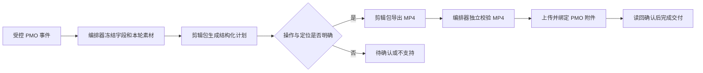

# VM / PMO 审核成片接口草案

日期：2026-10-09；2026-10-13 补充离线接入、两阶段配置、共同命名与成片归档。版本：完整生产接口草案 0.1；模板身份与配置草稿已实施，初稿纯保留范围的独立离线 v1 协议已冻结并联调，完整审核与交付合同仍为草案。

本文用于让新剪辑包与学科剪辑编排器分别开发、按同一接口验收。它是设计文档，不替代根目录 `AGENTS.md`，也不授权生产执行。包配置面板设计见同目录 `2026-10-09-package-workflow-templates-design.md`。

当前可识别固定模板、保存独立 VM 包草稿和学科字段/审批/阶段/共同命名/成片归档配置，并明确阻断启用。纯规则模块可校验并规划阶段文件名和归档目标，不写文件。示例 [vm-pmo-review-video-preview](../../../examples/vm-pmo-review-video-preview) 不包含运行时或渲染器。独立 VM 审批 CLI 已实现，尚未绑定 Taskboard task/run；初稿纯保留范围的 Taskboard→真实剪辑包 plan/render 已完成本机合成媒体联调，见 [离线接入说明](../../vm-pmo-offline-integration.md)。共同名称冻结、审核轮次和最新已交付制品指针的生产持久化、MP4/PMO 交付及 NAS 发布 worker 仍待开发。

## 1. 已确认的业务规则

1. 不同学科选择不同剪辑包时，显示该包对应的内置配置模板；配置值按学科、包和模板分别保存。
2. 新包需要开发。原始素材根据 PMO 的“原视频vmid”从 VM 取得。
3. 第一次剪辑使用原视频时间轴；多个保留片段按填写顺序拼接，不能按时间重新排序。
4. 后续审核修改以**上一轮审核成片**为素材和时间轴。
5. 只写“剪掉某几个字”时，默认连同对应画面一起删除，成片缩短。明确要求“只去声音／停顿占位”时，保留画面和时长，只静音对应音频。
6. 成片以 MP4 附件交付到同一 PMO 记录；不是只回写链接。拟使用现存“视频成片审核”字段，启用时还需核对字段类型和权限。
7. 2026-10-13 补充：初稿由 PMO 中配置的进度字段命中触发选项后启动，自动读取同一记录配置的 VMID 字段，申请下载审批并等待获批，下载后读取配置的剪辑意见，剪辑完成上传配置的附件字段。进度触发字段允许单选或多选。
8. VM 只设置“初稿”和“审核修改”两个阶段。初稿阶段配置「初稿意见」，审核修改阶段配置「审核意见」和可选的审核意见附件，删除独立 PMO 默认意见区及初审/终审之分。审核修改使用明确绑定的上一轮成片，完成后上传成片附件；每次重新进入同一审核触发选项开始新一轮，保持触发状态不变不重复执行。
9. 两个阶段各自配置实际开始剪辑时的回写，以及附件交付确认后的回写；素材等待不写“剪辑中”，上传响应成功本身不代表交付已完成。Auto-cut-lite 的生产 ZIP 三阶段配置不在此次调整范围内。
10. 初稿、审核修改和最终成片只选择一个共同文本或公式命名字段，名称主体相同，初稿为 `<共同名称>_初稿.mp4`，审核为 `<共同名称>_第N稿.mp4`，最终成片为 `<共同名称>.mp4`，不追加阶段后缀。N 自 1 开始，后续编排器须冻结名称与轮次，失败重试、上传重试不增加编号。
11. 成片归档使用独立状态触发，在 `<指定目录>\<共同名称>.mp4` 保存明确绑定的最终已交付 MP4，不重新剪辑。具体目录可手动输入或读取所选 PMO 文本/公式字段，不再配置课程目录命名，也不追加课程名或 `00成片`；最终视频名称来自共同命名字段，不能按附件顺序或修改时间猜测最终版。

下文的操作模型、导出参数、CLI 名称和附件保留策略是建议接口，不代表已经实现。

## 2. PMO 只读调研结果

本次完整读取的是用户所给视图中的 **18 条记录**，不是整张表的全部记录。18 条均有 VMID、保留时间字段和审核成片附件；3 条有非空“审核意见”，2 条有审核截图。已查看这两张截图。已有成片附件每条最多 3 个，列表顺序不能代表审核轮次。

| 实际记录／意见摘录 | 对接口的要求 |
| --- | --- |
| `0:00-2:31`；`2:34-结束` | 单段保留；“结束”在取得媒体并探测时长后解析。 |
| `0:04-1:23 +1:31（接下来）-2:29` | 按填写顺序拼接；括号中的语音定位提示须保留。 |
| `0:00-4:56+ 6:14-6：40`，审核称“4：56 还是能看到几帧表格的样子，请把他们剪干净” | 兼容全角冒号；在上一轮成片接缝附近定位并清理残留帧。不能统一提前一秒。 |
| `3:50（首先）-6:05`，审核称“前面有几帧之前的内容” | 根据上一轮成片和截图定位开头残留画面。 |
| `0:06-（4:22 剪掉 “中学阶段”这几个字的声音，可以用停顿占位）-4:34` | 保留区间与声音修改混写；必须提取独立静音操作，4:22 只是定位提示，缺少精确终点。 |
| 同条审核：“前5秒需要剪掉，从第六秒开始，到4分34结束，后面的需要剪掉” | 审核时间按上一轮成片解释；“前5秒／第六秒”存在口语边界差异，需要核对计划。不能照搬首剪区间。 |
| `0:30（语音是“首先”配后面1s只有NaOH的画面）-3:40` | 保留原音，以经确认的干净源帧覆盖目标窗口，直到新内容自然恢复；先定位语音起点、选帧与恢复边界。 |
| `0:31 剪掉“上一章”三个字，其他不变` | 这是局部删词指令，不是从 0:31 开始保留的区间。用户已确认默认删除对应音画。 |

两张截图分别显示“操作规范”表格画面，以及“氢氧化钙”标题下仍能看到其他碱相关内容的过渡画面。它们可辅助匹配目标画面；播放器控件和水印不属于新增剪辑要求。单张截图不能证明准确帧号、持续帧数或意见是否已在某个已有成片中处理。

本次未下载／分析成片音视频，所以尚未验证语音字词区间、实际残留帧边界或可执行的精确剪辑计划。原始 PMO 导出和截图保留在仓库外；共享文档不复制媒体 token、运行路径和凭据。

## 3. 职责与数据流



| 组件 | 负责 |
| --- | --- |
| Bridge / Taskboard | 保留官方 SDK 事件、受控来源登记、配置快照和本机执行资格校验；读取 PMO、准备素材、管理审核轮次、调用包、校验产物、上传与回写。 |
| VM 适配器 | 根据 VMID 通过已授权方式取得源文件，登记素材身份、哈希与媒体信息；处理未批准／失败等状态。 |
| 新剪辑包 | 理解字段文字和截图、定位语音／画面、输出结构化计划、执行支持的操作、导出准确绑定本次运行的 MP4 与回执。 |
| 用户 | 处理无法可靠定位、意见冲突或能力不支持的项目。明确且受支持的操作无需逐条确认。 |

这是学科剪辑编排器的包接口。飞书 CLI／SDK 仅是 PMO 读取与交付适配器，不是剪辑执行入口；新包不直接持有飞书或 VM 凭据，不自行申请下载、上传附件或修改 PMO。

### 3.1 学科配置与等待生命周期

配置按学科、包别名和模板身份保存。视频来源、申请信息、阶段进度、意见和命名字段、成片附件目标、状态回写及 NAS 成片归档属于学科 PMO 配置；全局只管理共享 Shadow 账号、独立下载队列和手动补救。当前界面保存的仍是草稿，不能绕过 `PACKAGE_WORKFLOW_NOT_READY`。

初稿链路为“状态进入触发值 → 冻结记录与 VMID → 自动申请 → 等待审批/制作 → 下载并校验 → 读取意见并冻结本轮输入 → 启动剪辑 → 写剪辑中 → 独立校验 MP4 → 上传和绑定附件 → 读回确认 → 写阶段完成”。意见在审批等待期间可能变化，因此取得素材后应重新读取，并再次确认记录仍处于该阶段。审核链路复用同一剪辑和交付流程，但素材明确绑定上一轮成片，不重新申请 VM 原片。

VM 阶段 ID 为 `initial / review`，分别表示初稿和可重复执行的审核修改。单选仅从其他值进入配置选项时触发；多选仅从不包含变为包含配置选项时触发，保留该选项时增删其他选项不重复执行。审核交付后须离开再进入审核触发选项，才开始下一轮，不能因状态一直停在待修改而无限剪辑。两个阶段同时命中时阻断为配置/状态冲突，不能任意选一个。离开触发状态归档尚未开始的匹配任务；已开始剪辑的任务依原有规则继续。Bridge 回写引起的事件继续经过阶段筛选及事件去重，不赋予普通或模拟来源执行资格。

素材等待保持 Taskboard `todo`，另显示待连接、待审批、制作中、下载中子状态，不占 Codex turn 或剪辑并发槽。申请绑定在 Taskboard 数据库，VM 状态库沿用原有两张表。同一冻结采集身份复用稳定输出目录和原申请；重启、授权失效及网络重试不重新提单。审批每分钟查询，24 小时提醒、7 天暂停可延长；驳回/撤销终止。ready 后复核任务未归档、来源、自动开关、白名单、包身份和资源摘要，才启动剪辑；关闭开关取消尚未开始的预约，再开启不补跑历史等待。

### 3.2 两阶段草稿与旧配置兼容

新草稿的 `fields` 保留 `vmidFieldId / outputAttachmentFieldId / namingFieldId`，分别表示 PMO 原视频来源、成片附件目标和唯一共同视频命名字段；`approval` 继续表示申请部门和原因。意见配置直接放在 `stages.initial / stages.review`，不存在额外的默认意见字段；阶段和归档对象不再保存独立视频命名绑定，顶层 `finalArchive` 表示独立成片归档：

```json
{
  "fields": {
    "vmidFieldId": null,
    "outputAttachmentFieldId": null,
    "namingFieldId": null
  },
  "approval": { "department": "", "reason": "" },
  "stages": {
    "initial": {
      "enabled": true,
      "statusFieldId": null,
      "triggerOptionId": null,
      "instructionFieldId": null,
      "writeback": {
        "processing": { "fieldId": null, "optionId": null },
        "completed": { "fieldId": null, "optionId": null }
      }
    },
    "review": {
      "enabled": false,
      "statusFieldId": null,
      "triggerOptionId": null,
      "instructionFieldId": null,
      "instructionAttachmentsFieldId": null,
      "writeback": {
        "processing": { "fieldId": null, "optionId": null },
        "completed": { "fieldId": null, "optionId": null }
      }
    }
  },
  "finalArchive": {
    "enabled": false,
    "statusFieldId": null,
    "triggerOptionId": null,
    "pathSource": "manual",
    "directoryPath": null,
    "pathFieldId": null
  }
}
```

初稿阶段的 `instructionFieldId` 在界面显示为「初稿意见」，审核修改阶段显示为「审核意见」；`null` 表示未选择，不再从隐藏默认字段继承。审核修改的 `instructionAttachmentsFieldId` 在同一阶段配置，可选绑定现存附件字段以保留审核截图来源。阶段触发字段接受现存单选或多选字段及其选项，意见只接受文本字段。回写使用现存单选字段及其选项，空字段/选项对表示不回写；不创建飞书字段或选项。成片目标使用现存附件字段。

`fields.namingFieldId` 和 `finalArchive.pathFieldId` 均为可空字段 ID，接受现存文本或公式字段，执行规划时按精确字段 ID 分别获取名称或具体目录结果并校验。「基础与执行」中只选择一次「视频主体命名字段」；素材与阶段页显示初稿、审核各自后缀提示，存储与目录页引用共同名称预览最终文件名，并选择手动输入目录或 PMO 路径字段。

旧独立视频命名绑定中所有非空字段相同时，GET 合并到 `fields.namingFieldId`；若有不同绑定则不猜选，共同字段返回 `null`，外层 `legacyNamingConflict: true` 提示显式选择。旧草稿缺少命名或归档配置时补齐 `null` 共同命名绑定和关闭的归档对象，默认路径来源为手动，其余绑定为空。旧根路径或课程字段绑定在 GET 时清空新目录绑定并返回 `legacyArchivePathNeedsReview: true`，保留原启用和触发配置，要求显式确认最终目录，避免静默改变目标。这些读取转换不写数据库、不增加 revision，也不自动标记未保存修改。显式保存仅接受完整 canonical 结构，移除独立命名绑定及兼容提示；旧路径结构、未知键、错误类型、非唯一或类型不符的实时字段绑定均被拒绝。

兼容旧五字段、三阶段草稿时，只在读取结果中转换为上述结构，不写入数据库、不改变 revision，也不自动标记未保存修改。初稿意见采用 `stages.initial.instructionFieldId ?? fields.keepSegmentsFieldId`。审核修改按完整阶段选择，依次优先：已启用的 `first_review`、已启用的 `final_review`、有实际配置的 `first_review`、否则 `final_review`；触发、启用及两种回写整体沿用选中阶段，不能拼接不同旧阶段的状态绑定。审核意见采用选中阶段的 `instructionFieldId ?? fields.reviewTextFieldId`，审核附件采用 `fields.reviewAttachmentsFieldId`。外层 `legacyReviewStage` 提示合并来源，界面提示用户核对配置；没有保留两个审核阶段并行执行的语义。

显式保存新草稿时仅保存两阶段及所选意见、附件、回写、共同 `fields.namingFieldId` 与六键 `finalArchive` 配置，移除旧三阶段结构、顶层默认意见字段和阶段/归档中的独立命名绑定；不把未选中的旧审核阶段或已被覆盖的默认字段带入新草稿。现有 Auto-cut-lite / ZIP 配置模型和生产 `initial / first_review / final_review` 三阶段规则保持原样。读取或保存 VM 草稿不会同步 Bridge、创建任务或推进活动配置，也不会创建 NAS 目录或复制成片。

这些草稿结构可以先行保存；实际两阶段触发、重复审核轮次、多选事件消费、任务素材绑定、MP4 驱动及上述回写时机仍须通过运行时验收后才允许启用。`PACKAGE_WORKFLOW_NOT_READY` 门禁保持有效，初稿离线联调也不构成审核阶段已接通的证据。

### 3.3 共同命名、阶段后缀与 NAS 成片归档

初稿、审核修改与最终成片统一使用 `fields.namingFieldId` 提供的名称主体：初稿固定追加 `_初稿.mp4`，审核修改固定追加 `_第N稿.mp4`，最终归档仅追加 `.mp4`，不添加初稿或稿次后缀。共同名称、字段快照和审核编号须由后续受控编排器冻结并持久化，同一轮计划、剪辑或上传失败后的重试复用它们；不能扫描目录、解析附件名或按成功上传次数猜测下一编号。公式字段必须提供可作为名称的有效结果；非法文件名字符先替换为下划线，去除尾点和空格，规避 Windows 保留名称；所有输出按同一固定主体预算截短，预留最大合法审核轮次对应的最长审核后缀，确保初稿、各轮审核与最终成片的名称主体一致；按 UTF-16 单元限制完整文件名不超过 180，不拆分代理对，并保留完整后缀。空结果或规范化后仍无效的名称阻断，不把单元格值解析为目录或命令。

`finalArchive` 只包含 `enabled / statusFieldId / triggerOptionId / pathSource / directoryPath / pathFieldId` 六键，默认关闭。存储与目录页可配置独立触发字段、触发选项和具体目录来源，视频名引用共同命名字段。`pathSource` 仅为 `manual` 或 `pmo_field`，分别使用 `directoryPath` 或 `pathFieldId`；切换来源保留两侧未保存输入，执行规划只使用所选来源，不回退。触发字段允许单选或多选；开启归档须完整配置触发字段、触发选项、对应路径来源并选定 `fields.namingFieldId`，同时禁止与任何已启用剪辑阶段使用同一触发字段及选项，避免同一状态同时要求剪辑和归档。单选从其他值进入归档选项、多选从不包含变为包含归档选项才触发；持续命中不重复归档。它是归档动作，不新增审核剪辑轮次。

具体目录可手动输入，或读取指定 PMO 文本/公式字段；两种来源均只接受 Windows 绝对盘符路径或完整 UNC，拒绝空结果、公式错误、相对路径、穿越和设备路径，PMO 字段只提供归档目录，不提供工作区、命令或 prompt。最终目标为 `指定目录\共同名称.mp4`，不再追加任何课程目录层级。映射盘保留实际盘符操作路径，身份使用解析后的 UNC；总目标路径长度仍受限。规划须引用同一 PMO 记录已确认交付的明确 MP4 身份和 SHA；缺少有效交付身份时阻断。后续 worker 从受控最新已交付制品指针冻结最终版，不按附件列表顺序、名称“最终版”或文件修改时间寻找素材。

`taskboard/server/feishu-vm-delivery-plan.mjs` 当前只实现无文件写入的规则校验和规划，不持久化共同名称、审核编号或最新已交付制品指针，不处理真实事件，不创建目录、上传附件或复制视频。实际发布须由后续 worker 验证源 SHA，临时复制并复核，再无覆盖原子发布；同名同 SHA 可幂等完成，同名不同 SHA 必须保留冲突且不覆盖，失败以持久化状态有限重试。这些是 worker 接入要求，不是共同名称冻结或 NAS 自动发布已在生产生效的声明，VM preview 门禁仍生效。

## 4. 包声明与调用

现有实现从受校验的 `PACKAGE-MANIFEST.json` 读取以下模板身份；`timelineBases` 与 `operations` 仍是待执行器验收的能力草案，当前配置预览示例不声明它们：

```json
{
  "interface": {
    "workflowTemplate": { "id": "vm_pmo_review_video", "version": 1 },
    "contract": { "id": "vm_pmo_review_video", "version": 1 },
    "driverId": "vm_pmo_review_video_v1",
    "timelineBases": ["vm_original", "previous_review_video"],
    "operations": ["keep_segments", "remove_av", "mute_audio", "freeze_frame"],
    "artifactKind": "review_mp4"
  }
}
```

包名称与版本沿用现有包身份文件；最终包名另定。`driverId` 必须命中编排器内置适配器，不能是包或单元格提供的命令。未知模板、协议、驱动或虚报能力都不能启用执行。

当前 validator 只接受两个内置模板的 v1：缺少 `workflowTemplate` 的历史声明解析为 `document_draft_zip`；显式 VM 合同或驱动缺少模板时直接拒绝。VM 的可选 `contract`、`driverId`、`artifactKind` 必须分别匹配上面的固定值；这些匹配只允许预览和保存草稿，不代表驱动已经可执行。已保存别名的模板不可变，更换流程须注册新别名。VM 示例未提供 `embedded_runtime`，检查结果的 `runtimeVersion` 为 `null`；旧模板继续要求原运行时版本。

最小固定调用形态（命令名为拟定协议入口，当前不可执行）：

```text
<registered-runtime> <fixed-entry> plan --input <input.json> --context <execution-context.json>
<registered-runtime> <fixed-entry> render --input <input.json> --context <execution-context.json> --plan <plan.json>
```

运行时、入口和路径由编排器从冻结的受信包身份生成。禁止拼接单元格 shell 文本。两个入口的结果路径分别固定在 context 内，不覆盖彼此回执。

- `plan`：产生计划，结果为 `ready` 或 `blocked`。即使存在阻断项，也保留完整意见清单及已理解的部分。
- `render`：仅接受输入、素材、计划哈希完全匹配且无待解决项目的计划；结果为 `rendered`、`blocked` 或 `failed`。
- 退出码建议：`0` 表示已写出合法回执，业务结果必须读取 `status`；`2` 表示参数／协议错误，`3` 表示运行异常。非零退出码、回执缺失或非法均不能判成功。
- 输出先写临时文件再原子发布到准确路径；不扫描目录，不选择“最新 MP4”，旧文件不能充当本次成功输出。

## 5. 输入与本轮身份

### 5.1 文件边界

| 文件 | 核心内容 |
| --- | --- |
| `input.json` | 版本、包身份、任务绑定、PMO 字段快照、素材身份、意见适用性、导出配置；不含平台凭据或任意命令。 |
| `execution-context.json` | 编排器生成的本机路径：输入对应哈希、素材／截图 ID 到准确文件的映射、本次 plan/result/MP4 路径、工作目录。 |
| `plan.json` | 输入哈希、素材哈希、逐项意见处理结果、有序剪辑序列和精确操作；由包生成，编排器验证。 |
| `plan-result.json` / `result.json` | 分别记录计划结果和渲染结果，包含相同任务身份以及引用文件的哈希。 |

所有 SHA-256 采用小写 64 位十六进制，按已落盘的 UTF-8 JSON 或媒体文件的**实际字节**计算；JSON 文件冻结后不重新排版。哈希由引用者存储，文件不包含自身完整文件哈希，避免自引用。context 与 input/plan/output 都限制在本次受控运行路径内；素材只读，路径不是来自飞书字段。未知协议版本／字段必须拒绝或经过显式迁移。

### 5.2 必填内容

| 字段 | 规则 |
| --- | --- |
| `protocol`, `schema_version` | `vm_pmo_review_video`、`1`；独立于旧 source-manifest v1。 |
| `package` | 冻结 alias、name、version、manifest SHA、template ID/version；启动时复核部署身份。 |
| `binding` | task_id、run_id、subject_key、config_version、stage_id、event_id；原样回传并精确比较。VM 阶段使用 `initial / review`；同一 `review` 的不同轮次仍须独立绑定。当前离线执行仅开放 `initial`，审核输入保持阻断。 |
| `record` | base_token、table_id、record_id；与受控任务及 subject_key 一致。 |
| `review_round` | 编排器生成的 round_id、本轮 input snapshot ID、parent review-video reference（初稿为 null）。同一阶段可多轮，不能只用 stage_id 标识轮次。 |
| `source` | source_id、timeline_basis、原始 vmid、本次实际文件 SHA、字节数、探测时长、流信息及来源证明。 |
| `instructions` | 按字段保存原文、图片引用、field_id、用途、时间轴及本轮适用性；不可只存解析后的区间。 |
| `output_profile` | 版本化 MP4 规格；音频原音及逐操作例外、画面尺寸与帧率策略、允许的校验误差。 |
| `delivery_target` | 冻结 record 与 attachment_field_id、交付策略；包只回传身份，编排器负责交付。 |

推荐映射（名称为当前观察结果，配置保存字段 ID，执行时重新校验）：

| 输入用途 | PMO 字段 | 类型／使用时机 |
| --- | --- | --- |
| 成片名称 | 视频名称（10字以内） | 文本，仅用于安全生成展示名，不能成为路径。 |
| 原始素材 | 原视频vmid | 单一非空标识。 |
| 首剪要求 | 剪辑保留片段的时间点 （可由多个片段拼到一起） | 文本，包含区间及括号操作；初稿使用。 |
| 审核要求 | 审核意见 | 文本；本轮适用内容，不自动重用已消费的历史意见。 |
| 审核画面依据 | 审核意见截图说明 | 图片附件；按冻结的精确附件引用取得并验证图片类型与哈希。 |
| 输出 | 视频成片审核 | 已存在、可写的附件字段。 |
| 阶段触发 | 剪辑进度或配置指定字段 | 既存单选或多选字段及配置选项；不根据历史记录现值自动执行。多选须发生不包含→包含的变化。 |

`instructions` 的每一项至少具有 `instruction_id / source_field_id / raw_text或image_ref / timeline_basis / applicability`。`applicability` 为 `current_round / historical_context / unresolved`。截图单独编号并保留附件来源与内容哈希；附件顺序只用于引用展示，不决定审核先后。

### 5.3 审核轮次与防止重复剪辑

- 初稿 `timeline_basis=vm_original`。初稿字段里只有局部修改、明确写“其他不变”时，基础画面为完整原视频，不能把定位时间误读为截取起点。
- 审核 `timeline_basis=previous_review_video`。parent 必须是同一记录被明确指定的上一轮成片，身份分为 `managed_run` 和 `imported_review_video`。`managed_run` 绑定 artifact ID、run ID、delivery ID、SHA 和时长；`imported_review_video` 仅绑定 import ID、acquisition ID、准确附件来源、SHA、时长和用户选定确认，不具有也不伪造 run、artifact 或 delivery 身份。本轮先冻结 parent，重试期间不随新附件改变。
- 历史“保留时间点”字段仍属于原视频时间轴，审核时只作为 `historical_context`，不能自动对上一轮成片再裁一次。
- 若要把首剪字段中的新修改用于审核，须显式指定其本轮适用性和成片时间轴；不能仅凭字段名或填写时间猜测。
- 用上轮已消费意见快照与当前快照作比较；它只能发现变化，不能证明新旧语义。已交付轮次后又触发相同意见、意见适用对象不明或仅截图重复时，先阻断确认，避免二次删词。
- 当前表有历史成片但没有本系统 run 身份。首次接入审核时允许显式导入为 `imported_review_video`：选定准确附件、下载校验，登记 import ID、acquisition ID、同一 PMO 记录的准确附件来源、SHA／时长和用户选定确认；不生成或填写 run、artifact 或 delivery ID。不得按文件名“终审02”、附件次序或修改时间自动猜测。导入仅建立素材身份，不授予任务执行资格。
- “上一轮”不等于固定前一阶段；同阶段再次修改也以明确绑定的上一次成片为 parent。

## 6. 剪辑计划与四种目标操作

完整流程需覆盖下面四种能力，避免接收全部意见后只做裁剪拼接。首个离线协议样例只接收明确的保留范围；其余意见保持 `blocked`，待证据与操作适配完成后逐项开放。

| 操作 | 语义 | PMO 对应需求 |
| --- | --- | --- |
| `keep_segments` | 定义有序保留区间，保持原音并直接拼接；无明确转场要求则不自动加转场。 | 单段、多段、到结束。 |
| `remove_av` | 删除指定区间音画、闭合空隙，时长缩短。 | 删词默认行为、首尾和接缝残留帧。 |
| `mute_audio` | 指定区间音频静音，保留画面和时间；不自动合成替换语音。 | “中学阶段”的声音用停顿占位。 |
| `freeze_frame` | 保留目标窗原音，以同一绑定素材中经确认的单帧覆盖画面，直至新内容自然恢复，时长不变。 | “首先”配后面只出现 NaOH 的画面。 |

### 时间与定位

- 解析层接受半角／全角冒号、空格、`+` 分段、`M:SS`／`H:MM:SS` 和可选毫秒；归一化后验证秒／分范围，裸单个时间点只能作为定位提示。不支持的写法保留原文并阻断，不能默默忽略括号。
- 计划使用整数毫秒半开区间 `[start_ms,end_ms)`；`0 <= start < end <= source_duration_ms`。数组顺序就是拼接顺序。重复区间可以表达重复播放，不做隐式去重；可疑重叠进入计划提示。
- “结束”在探测媒体后变成具体数值。“首先”“上一章”“几帧”等必须结合音视频定位，不能根据文本自行补一个固定长度。
- 用语音识别／对齐提出字词区间，用画面与截图比对提出帧区间；零匹配、多匹配、边界不清、文字与截图冲突均为待确认。工具和模型选型另定，不把模型推测当成已完成操作。
- 解码后按实际视频 PTS 选择帧，按音频采样边界对齐。记录从文本时间到实际区间的调整及误差；不能用关键帧跳转或无损流拷贝假装精确清掉几帧。变帧率视频不能只用名义 FPS 推算。
- “前5秒／第六秒”应显示明确的 `00:05.xxx` 或 `00:06.xxx` 候选界限后再决定，不能以语言歧义自动定界。

### 坐标与组合

所有操作都引用本轮 `source_id` 和哈希，坐标始终基于**剪辑前的本轮素材**，不随之前操作缩短而移动。每段保留片段分配 `segment_id`；修改操作同时指定作用的 segment，避免相同源片段被重复使用时错误地修改所有副本。

先确定有序保留区间，再在各段中应用删除／静音／静帧，最后拼接并生成源时间到输出时间的映射。跨 segment 操作需显式拆分。删除、静音、静帧的目标范围冲突时，先解决冲突，不能靠操作列表顺序偷偷覆盖。

静帧须记录经确认的源帧时间和目标覆盖起止；选帧可位于本轮素材的非保留区间。像“后面1s”这种描述并未给出干净帧或恢复边界，不能直接猜测。缺少画面证据时标记待确认，不能静默改变语速或填黑帧。

每一条输入意见都必须对应 `resolved / needs_confirmation / unsupported` 处理项及依据，可将一条拆成多个操作。只要还有未解决条目，计划不能进入 render。确认记录绑定 input SHA、source SHA 和 plan SHA；任何改动使原确认失效。明确、能可靠定位且受支持的操作可直接生成 ready 计划。

### 不含真实业务数据的计划片段示例

以下只是顺序与坐标示意，不是可直接执行的完整输入：

```json
{
  "timeline_basis": "vm_original",
  "segments": [
    { "segment_id": "s1", "source_id": "source_1", "start_ms": 4000, "end_ms": 83000 },
    { "segment_id": "s2", "source_id": "source_1", "start_ms": 91000, "end_ms": 149000 }
  ],
  "operations": [],
  "expected_duration_ms_before_frame_alignment": 137000
}
```

## 7. MP4 与结果回执

导出规格 `review_mp4_v1`：MP4 容器、H.264 视频、AAC 音频、常见播放器兼容像素格式与 faststart；成片统一 1920x1080、25 fps，源画面等比补边，默认保留原音，按上节操作例外处理。VM 采集可为 1280x720，采集尺寸与输出尺寸分别核验；升采样不代表画质提升。不擅自改语速或补配音。

不能简单规定“任何输入原样保留”：遇到编码不支持的尺寸、时间戳或流布局时明确阻断或给出待确认的转换方案。经探测确认源素材没有音频流，且冻结的 `output_profile` 允许无音轨时，不凭空加声音，回执 `audio=null` 合法。源素材有已选定音轨、冻结配置要求保留音轨，或操作需要在音频上生效时，产物必须有音频流；全程静音仍应保留静音音轨，不能写为 `audio=null`。这类应有音轨缺失属于 `EXPECTED_AUDIO_TRACK_MISSING`，必须以 `MEDIA_VALIDATION_FAILED` 失败，不能登记为成功产物。

`result.json` 必须包含：

- `protocol / schema_version / status / binding / package identity`。
- 本轮 `input_sha256 / plan_sha256 / source_sha256 / parent review-video reference`。
- `rendered` 时唯一 artifact：`kind=review_mp4`、context 指定的准确路径、SHA、字节数、实测时长、视频／音频编码、尺寸、帧率或 PTS 摘要，以及逐项验收结果。
- `blocked` 或 `failed` 时没有成功 artifact；只返回稳定错误码、相关 instruction ID、是否可重试及不含敏感数据的说明。临时输出不算成功。

编排器独立复核路径与本轮绑定、哈希、实际媒体流、可解码性和时长；不能只相信包给出的 `validation_passed`。理论时长从帧对齐后的保留区间减去删除区间计算，静音和等长换画面不改变时长。音视频误差按实际视频帧时长及音频包／采样精度定义并验收，不沿用旧文档音频替换的“3秒”容差。视觉残留及语音边界另用对应样例验证，哈希和可播放检查无法证明编辑语义正确。

稳定错误码建议：`SCHEMA_UNSUPPORTED`、`RUN_BINDING_MISMATCH`、`SOURCE_MISSING`、`SOURCE_HASH_MISMATCH`、`SOURCE_APPROVAL_REQUIRED`、`PARENT_REVIEW_VIDEO_REQUIRED`、`INSTRUCTION_ROUND_UNRESOLVED`、`RANGE_INVALID`、`RANGE_OUT_OF_BOUNDS`、`WORD_ALIGNMENT_UNRESOLVED`、`FRAME_MATCH_UNRESOLVED`、`OPERATION_UNSUPPORTED`、`REVIEW_CONFIRMATION_REQUIRED`、`PLAN_BINDING_MISMATCH`、`RENDER_FAILED`、`EXPECTED_AUDIO_TRACK_MISSING`、`MEDIA_VALIDATION_FAILED`。

包的 `rendered` 只表示产物准备完成；它无权宣布 PMO 已交付或推进 Taskboard 任务完成。

## 8. 附件交付合同

建议首版采用**追加新成片并保留已有附件**。是否今后只展示最新版可作为独立产品设置，不能在重试时覆盖已有附件。

```text
MP4 verified → upload pending → media uploaded/token persisted
→ binding pending → attachment read-back confirmed → delivered
→ task complete / stage writeback pending → stage writeback confirmed
```

1. 由 MP4 验证成功直接入独立交付队列；不能要求任务先 done 才允许上传。
2. 交付身份固定为本轮 run、artifact SHA、record、field；持久化 token、租约、尝试次数和安全错误码。取得 token 不等于已经绑定附件字段。
3. 绑定前重读字段，保留其他附件；已含本次 token 时直接进入核对，不再次追加。
4. 通过认证的本机专用接口执行附件绑定，服务端从可信运行身份解析目标和制品。不能允许单元格或普通任务传入任意路径／token 作为可信产物。
5. 读回确认目标记录字段包含本次 token 后才能记为 delivered、建立下一轮 parent 候选并完成任务。阶段状态写回独立重试且可见；失败不重新渲染。
6. 阶段状态回写前重新核对字段、选项和当前流程轮次。若用户已经推进到下一轮，不把旧轮次状态覆盖回去；记录跳过／冲突结果。
7. 上传／绑定失败优先复用已验证 MP4 和已保存 token。上传成功但响应丢失时记录结果不确定并恢复，不能宣称 exactly-once。
8. 附件更新若没有上游原子比较交换能力，仅“读后合并写”不能严格防住人工并发修改；本机同记录串行、重读校验、检测冲突后暂停重试，并在真实联调中验证接口能力。不得承诺无条件保留并发更新。
9. 上传大小限制、授权范围和必要的分片上传在实际集成中验证；现有样例有数十 MB 成片。不得只用小图片上传成功来宣称 MP4 交付已经可用。

## 9. VM 下载与兼容边界

已验证 VM 可按 PMO VMID 精确定位素材，正常网页/后台提交申请后通过飞书审批取得下载资格。后台申请详情能直接返回资源及制作状态，因此后续领取无需读取邮箱。

用户提供的《【生产环境】上传视频自动化说明》描述的是上传、创建制作任务和按任务 ID 查询状态；下载通路来自随后实测的 VM 当前 Shadow 前端契约，尚无正式外部客户端稳定性文档。

VM 适配器至少应交付 `vmid / acquisition_id / status / source file SHA / size / duration` 和准确本机文件映射；`status` 区分 ready、审批阻断和 failed。已实现两个独立 CLI（详见 [VM 素材采集验证](../../vm-source-acquisition.md)）：`vm-source.mjs` 接收操作者提供的获批 URL/本机文件；`vm-approval.mjs` 使用正常 SSO、持久化申请队列、唯一申请匹配、审批查询和获批下载。worker 必须同时核对 `APPROVED`、目标 VMID、`HIGH` 与 `finished`，再验证实际 1280x720 文件；响应不明时不重复提交或消费下载地址。

已在公司 VPN 下验证真实获批视频下载、SHA、元数据和全量解码；后台提交申请也已独立验证。新审批 CLI 已实际接管既有获批申请，通过精确回执复核返回 `ready`，未重新申请或下载；复用的旧回执保持 `operator_asserted`。新 worker 的全新申请到首次下载仍待真实整链路验收。以上状态尚未绑定本接口的 Taskboard task/run、parent 审核轮次或 PMO 交付。令牌只在内存中，重启后重新登录，长期自动续期未实现；凭据和下载 URL 不进入共享 manifest 或普通日志。

现有 `document_draft_zip` 继续使用旧 source-manifest/result/receipt、Lite driver、ZIP 校验及 NAS 发布。新模板使用独立协议与 MP4 交付，不能把新字段塞进拒绝未知字段的旧 v1，也不能调用旧 `review-document-run` 并声称完成成片附件交付。

当前根 `AGENTS.md` 的完成条件是唯一 ZIP 发布。实施新附件分支前需要同期更新该规范、README 和测试，明确两种完成条件；本草案不改变运行规则。Bridge loopback、专用来源登记、自动开关、automatic 活动快照、包白名单和模拟来源限制保持有效。模拟事件不得下载生产素材、执行实际剪辑或上传／回写；离线包测试使用显式 fixture，与事件模拟入口分开。

## 10. 验收样例与下一步

以下为待实现的验收矩阵，本次没有运行剪辑测试：

| 样例 | 期望 |
| --- | --- |
| 单段、多段、“结束”、全角时间、倒序填写区间 | 按原文顺序输出；实测时长和音画连续性正确。 |
| 时间字段括号里包含静音／换画面要求 | 每项均进入计划，不能仅裁剪后报成功。 |
| 指定词语删除 | 默认删音画并缩短；同词多次出现不能误删，缺边界需确认。 |
| 明确只删声音并占位 | 画面／总时长保持，目标语音消失，其他音频不受影响。 |
| 首尾／接缝几帧残留与截图 | 精确清理实际匹配帧，不统一减一秒，不删除邻近有效内容。 |
| “首先”语音 + 后续 NaOH 画面 | 语音窗口和 donor 可验证、等长替换；不等长时阻断，不擅自变速。 |
| 审核第二轮、同阶段第三轮 | 使用明确 parent；不套用原视频保留区间，不二次消费旧意见。 |
| 历史记录有多个成片 | 未选定 parent 时阻断；导入后绑定准确 hash，不猜“最新”。 |
| 意见、源文件、计划、包版本或 run 被替换 | 哈希／身份校验失败，旧确认及旧文件不能复用为新成功。 |
| 导出损坏、错路径、错时长、应有音轨却缺失 | 不登记为成功产物，不上传。源无声或确认方案允许无音轨时不误报。 |
| 上传失败、绑定失败、进程重启、响应丢失 | 受控恢复并复用已有资源，不重复剪辑、不提前完成。 |
| 已有附件及人工并发更新、旧轮次状态回写 | 不盲目覆盖；冲突可见，不能把旧状态写回新轮次。 |
| 旧包／旧学科配置／历史 ZIP 任务 | 保持原协议和完成条件。 |

配置模板身份和草稿界面已完成，纯确切保留范围的 plan/render 已通过不含凭据的离线合成媒体联调。下一阶段将审批 CLI 绑定受控 task/run，持久化等待、拒绝、超时与恢复；再补齐带证据编辑、审核 parent 和附件交付，最后用测试表及获批 VM 素材验收全链路。

冻结接口前仍需落实：独立审批领取到 Taskboard task/run 的绑定、实际视频的字词与帧定位验收、默认导出质量的样片验收及 MP4 附件交付。真实执行包最终名称和源码目录可在开始开发时确定；当前示例仅用于配置预览。以上不需要用户重复回答已确认的时间轴与删词规则。
